# 🧠 Elton AI

Talk to your Obsidian vault — by voice or in writing. It searches your notes,
answers out of them, files new ones from your own templates, and reaches you on
your phone from a browser or a Telegram bot.

**[Русский](#-elton-ai-по-русски) · English**

Works on desktop and on mobile (Android / iOS).

> **A key and a free trial live in the Telegram bot
> [@elton_ai_obsidian_bot](https://t.me/elton_ai_obsidian_bot).**
> Open it, press Start, and you have a key. Promo code **Gift** gives you
> credits to try the whole thing without putting anything in. Your own key from
> OpenAI, OpenRouter or a local Ollama works just as well — the plugin takes any.

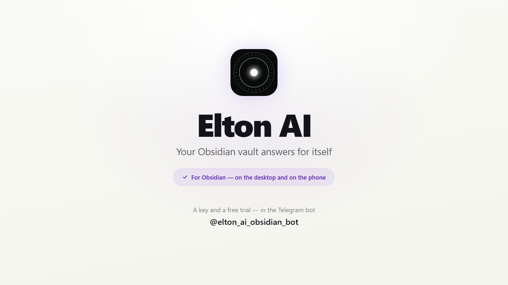

### ▶ Two minutes of it actually running

[](https://www.youtube.com/watch?v=UHazxHln1aM)

*[Talking to my SECOND BRAIN like it was ChatGPT — Obsidian without sync](https://www.youtube.com/watch?v=UHazxHln1aM)* — a real vault, a real phone, nothing sped up.

|  |  |
| --- | --- |
| 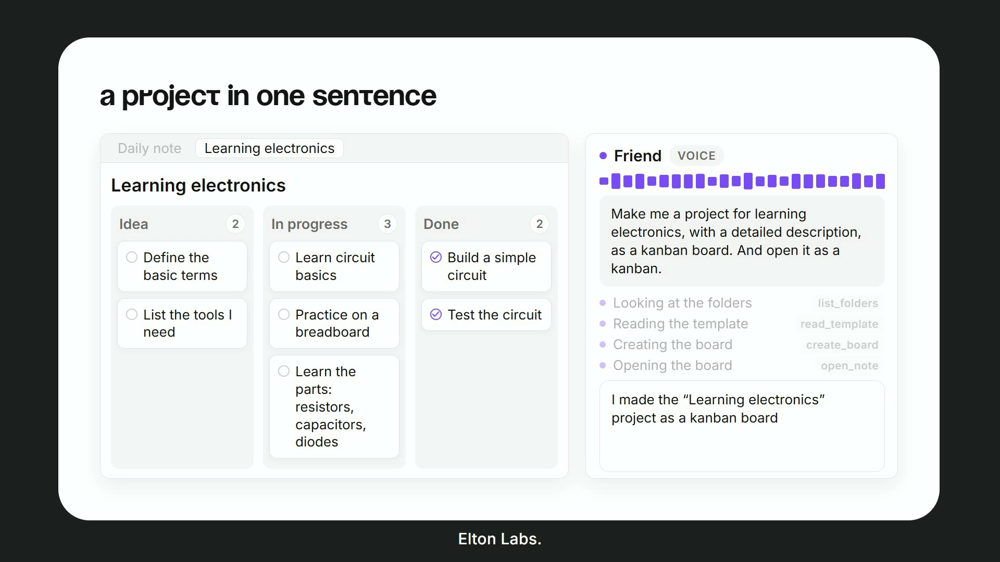 | 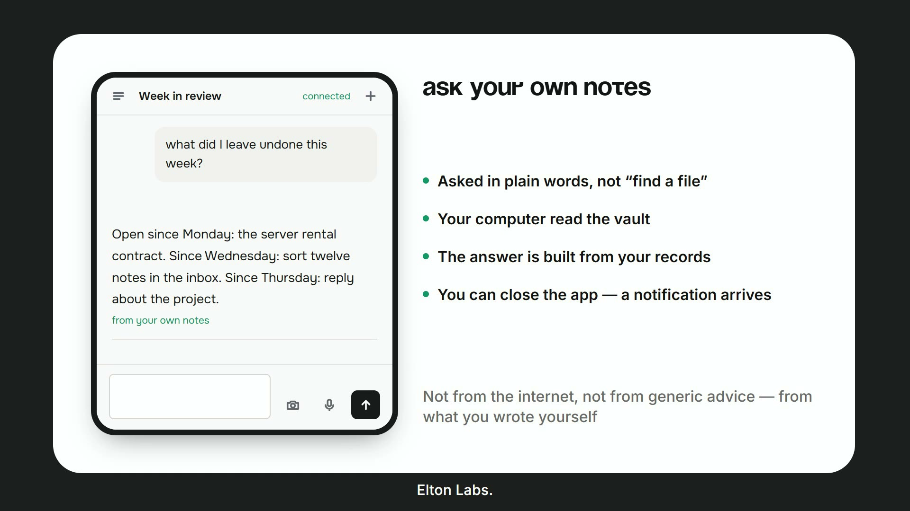 |
| **A project in one sentence** — say what you want and get a real Kanban board, built from your own template, opened for you. | **Ask your own notes** — in plain words, not "find a file". The answer is assembled out of what you wrote, not out of the internet. |
| 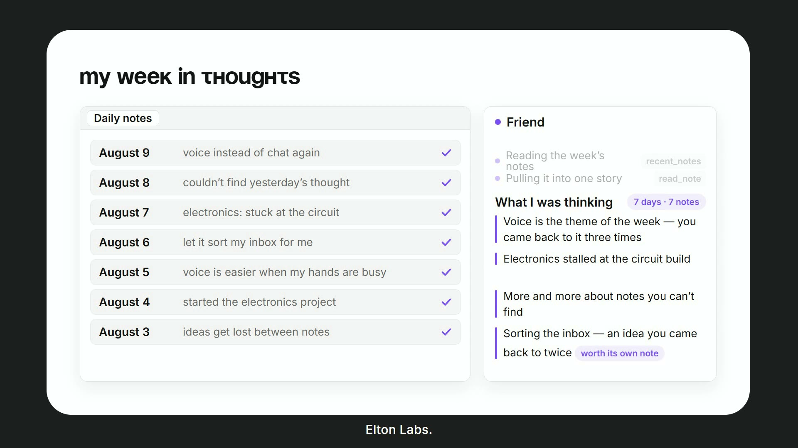 | 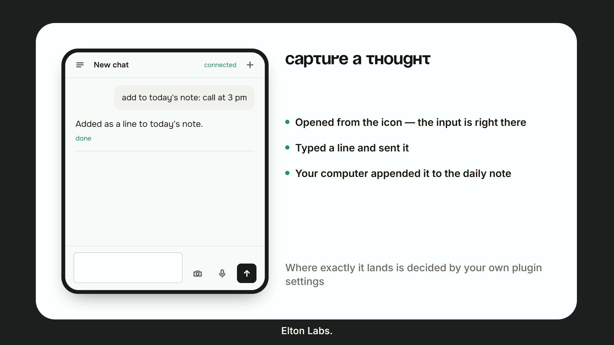 |
| **My week in thoughts** — it reads back through the daily notes and tells you what you kept returning to. | **Capture a thought** — one line from the phone lands in today's note. Where exactly is decided by your own settings. |
| 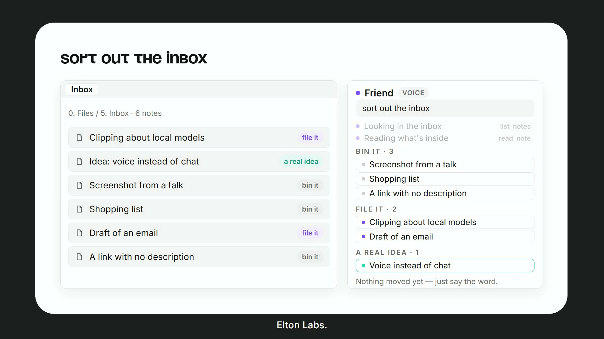 | 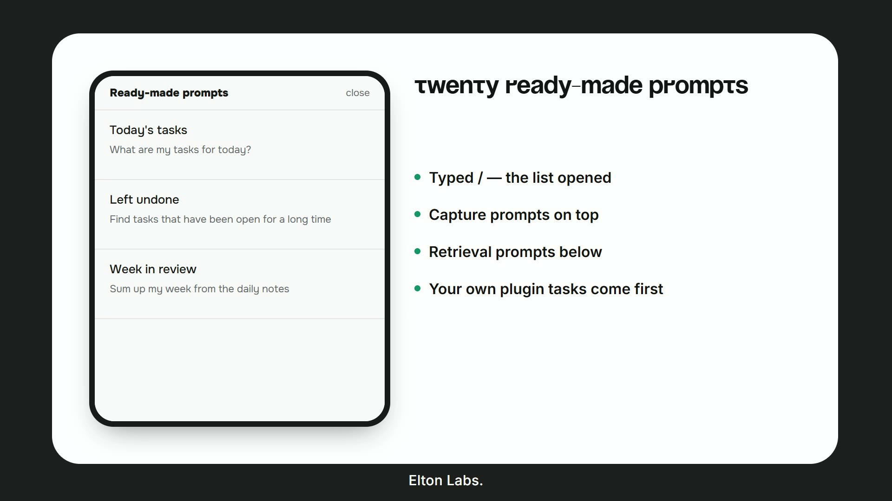 |
| **Sort out the inbox** — it proposes a folder for every loose note and moves nothing until you say the word. | **Ready-made prompts** — type `/` and pick. Your own saved tasks come first, twenty useful ones come after. |
| 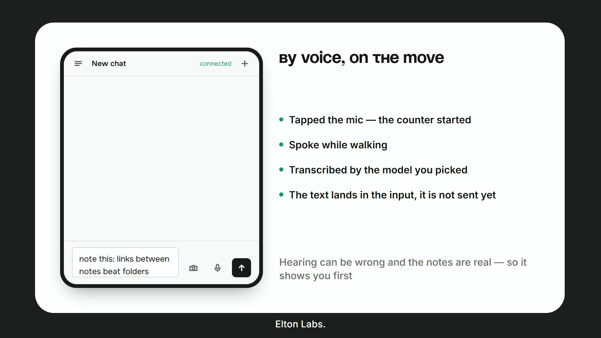 | 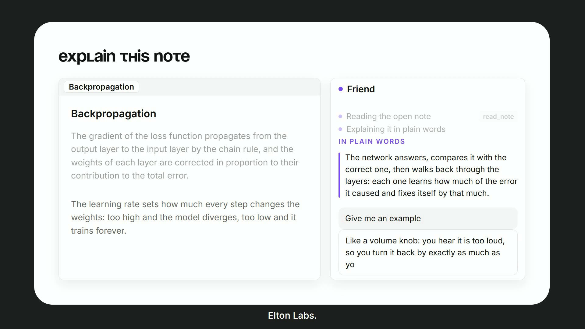 |
| **By voice, on the move** — hold, speak, and the transcript lands in the input before anything is sent, so a misheard word is yours to fix. | **Explain this note** — it answers about the note in front of you, in plain words, and will give an example if you ask. |
| 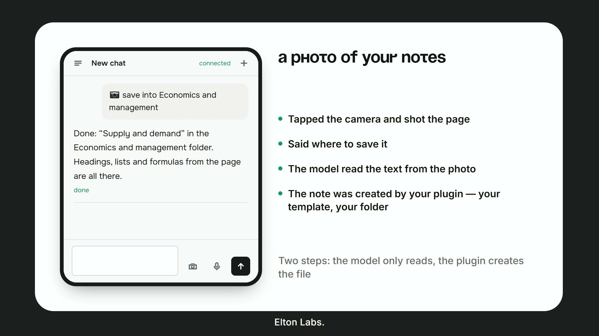 | 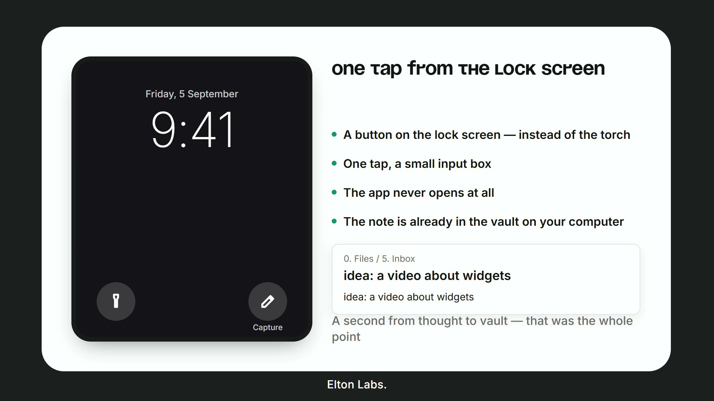 |
| **A photo of your notes** — photograph a page, say where it goes, and the note is created from your template. | **One tap from the lock screen** — a write-only key for a shortcut that can create a note and nothing else. |

---

## What it does

**Answers out of your vault.** Keyword search and, if you switch it on, meaning
search over an embedding index. It reads the note on screen, the daily notes, a
folder, a span of days. It says when it found nothing instead of inventing an
answer — and for a question about the world rather than about your notes, it
simply answers, then points at where your own notes touch it.

**Writes and files.** New notes from your templates, into the folder the vault
already uses for them. Appends a line under a heading. Edits a note in place.
Builds Kanban boards and Bases that actually render. Never deletes without
asking.

**Voice both ways.** Hold a key and talk, or run a hands-free conversation.
Speech in through your provider; speech out through a cloud voice or a local
Piper, so the vault can talk without anything leaving the machine.

**Tasks and automations.** A saved prompt behind a phrase ("what was I thinking
about") or behind a time of day. Results land in a note, in a notification, in
Telegram, or in the app.

**Your choice of brain.** Elton AI, OpenRouter, OpenAI directly, or a local
model in Ollama / LM Studio. You bring the key; the plugin keeps it in this
vault and nowhere else.

---

## The app on your phone

The headline of 3.0. The Connector tab gives you a code; type it once in the app
and the whole vault is with you — ask it something, dictate a note, add a line to
today's. The app installs onto the home screen straight from the browser at
[app.eltonlabs.org](https://app.eltonlabs.org): no app store, no account.

**Nothing answers on a server — your own computer does**, which is why the notes
never leave it. So there is one condition: the computer on, Obsidian open, the
connector switched on. While it sleeps the app says it is not connected, and
whatever you send waits in the queue and arrives the moment the computer is back.

The phone and the computer derive a shared secret between themselves
(ECDH P-256 → HKDF → AES-GCM), so the relay in the middle carries text it cannot
read.

Setting it up step by step, with a short video per step:
**[eltonlabs.org/en/elton-ai-app](https://eltonlabs.org/en/elton-ai-app)**

---

## Install

Settings → Community plugins → Browse → search for **Elton AI** → Install →
Enable. If *Restricted mode* is on at the top of that page, turn it off first —
while it is on, Obsidian runs no community plugin at all.

The setup guide opens the first time you run it, and can be reopened any time
from Settings → Elton AI → **Show the setup guide again**.

### Beta versions, with BRAT

1. Install **BRAT** from the community plugins list.
2. BRAT → *Add beta plugin* → `swayinfo/elton-ai`
3. Enable **Elton AI** in Community plugins.

### By hand

Download `main.js`, `manifest.json` and `styles.css` from the
[latest release](https://github.com/swayinfo/elton-ai/releases/latest) into
`<vault>/.obsidian/plugins/elton-ai/`, then reload Obsidian.

---

## Open source

**The plugin is here, in the open** — every line that runs inside your Obsidian
is in `src/`, and `main.js` in each release is built from it by the workflow in
this repository, with build provenance attested. Read it, fork it, build it
yourself, check what it sends.

What is *not* published is the relay the app talks to, and that is deliberate
rather than coy. The relay exists because almost nobody has a server: without it
you would need a public address for your own computer, a certificate and an open
port, which is not a thing to ask of someone who just wants to write a line from
the bus. Running it is a service — a postman, nothing more — and it is free to
use. It carries ciphertext it cannot read, keeps a message for at most three days
and stores no notes at all: the [privacy section](#privacy-and-external-services)
lists everything that crosses it.

If you would rather depend on nobody, the plugin is fully usable without the
relay: the panel, the voice, the tasks and a local model in Ollama need no
network at all.

---

## Privacy and external services

### Private folders

Answering a question sends parts of your notes to your provider. So there is a list of folders it never touches: **Settings → Vault → What it may do → Private folders**.

"Never" means: not read, not found by search, not indexed, not sent — and not offered as "the note on screen" even when it is open in front of you. The check runs before every other one and does not depend on the working scope: in "whole vault" mode private folders are still closed. Subfolders are closed with their parent.

This is where medical records, finances, passwords, other people's information and anything under an agreement belong.

It is not the same thing as "where it may work". The scope answers "which part of the vault does it live in day to day" and has three modes that exclude each other — there is no way to say "work everywhere except my medical notes" with it. Private folders answer a different question and apply on top of the scope.

There is also a weaker list, **"Left out of the index"**: those notes can still be opened when you ask for one by name, they are simply never sent away in bulk when the index is built. As useful for a large archive you would rather not pay to embed as for anything delicate.

### Where requests go

The plugin contacts the provider you chose in settings, and — only if you switched them on yourself — the bot and the connector. It carries no key of its own and no hidden addresses; this list is exhaustive.

| Address | When it is used | What is sent |
|---|---|---|
| `api.eltonlabs.org` | the **Elton AI** provider | the request, the note fragments found for it, and the audio of what you said, for transcription |
| `openrouter.ai` | the **OpenRouter** provider and web search | the same |
| `api.openai.com` | the **OpenAI** provider | the same |
| `localhost:11434` | a local model (Ollama / LM Studio) | nothing leaves the machine |
| `localhost:5000` | the local Piper voice | only the answer text, to be spoken |
| `api.telegram.org` | only if you connected a bot | your messages to the bot and the assistant's replies |
| `media.giphy.com` | only the Telegram waiting animation, once | nothing — a picture is downloaded |
| `app.eltonlabs.org` | only if you switched the **connector** on | your messages from the app and the assistant's replies — encrypted end to end, so the relay carries text it cannot read. Besides those, your Elton AI key, once every few hours: a connection code is only claimed against a working key, or anyone could reach a vault by inventing twelve characters. The key itself is not stored on the server |
| `relay.eltonlabs.org` | the same, as a fallback address | the same |
| `base.eltonlabs.org` | only when you top the balance up from the app | the amount and your key, to get a payment link back |
| `api.eltonlabs.org/skills` | only with the Elton AI provider | nothing is sent; short guides to Obsidian's own file formats are fetched, so the assistant writes a Kanban board or a Base that actually renders |

Elton AI is the author's own service, for people who would rather not set up an account and a key somewhere first: one balance, topped up from a Telegram bot, no card details left with a foreign provider and no separate signup. There is a free trial to see whether the whole thing suits you — promo code `Gift` — and what it costs, which models it covers and how to top it up is on **[eltonlabs.org/en/elton-ai](https://eltonlabs.org/en/elton-ai)**. Using it is also what pays for this plugin being worked on. Every other provider works without it and the plugin loses nothing.

**Two things the catalogue's review flags for any plugin like this, spelled out.** The plugin asks Obsidian for the list of files in the vault — that is what makes search possible at all — but a file being listed is not a file being read: contents are only opened when a question needs them, and private folders are excluded from the list itself. And it writes to the system clipboard, for the "copy" buttons under an answer and under an automation's result. It never reads the clipboard.

**No telemetry, and no self-updating.** The plugin collects nothing about you, keeps no statistics, and sends no analytics anywhere. It does not download code, dependencies or updates of itself — new versions come from the community catalogue or from BRAT, like any other plugin. The guides mentioned above are plain text for the model to read, not code, and the plugin ships with its own copies built in; the service only adds to them.

Requests to a provider are seen by that provider, as with any API — that is true of OpenAI and OpenRouter as much as of Elton AI, which keeps no copies of your notes. If you would rather not rely on someone else's service at all, use your own key or a local model, and the author's service is never contacted.

Your notes stay in your vault. Only the text needed to answer the question at hand is sent: the fragments found, the note on screen, and the context note.

Keys are stored in `data.json` inside the plugin's folder as plain text — that is how every Obsidian plugin works. Do not keep keys in a vault you share publicly.

With a local model, nothing goes out at all.

---

## What's new in 3.0

**The app on your phone.** The whole point of this version — see above.

**A button for one thought.** A separate write-only key, for a shortcut on the
lock screen. It can create a note and nothing else: no reading, no editing, no
deleting.

**End-to-end encryption.** The phone and this computer work out a shared secret
between themselves; the relay carries text it cannot read.

**It can read a photograph.** Photograph a page of notes, say where it belongs,
and the note is written from your template. Latin abbreviations stay in Latin,
and anything genuinely unreadable is marked rather than guessed.

**Voice on the OpenAI provider works again.** Its transcription lives on a
different endpoint than the chat models, and the request is built for that
endpoint now. Other providers are unchanged.

**The search index says when it has fallen behind.** Once a week, and only when
enough notes have piled up outside it.

**A question about the world gets an answer.** Asked what a thing is, it
explains it instead of searching your vault for the word and reporting nothing
found — and then points at where your own notes touch the subject.

---

## Building from source

`main.js` is assembled from the files in `src/` by concatenation, in the order
`build.sh` lists — no bundler, no build step to trust.

```sh
sh build.sh      # writes main.js
npm run lint     # the checks the community scanner runs
npm test         # 446 assertions
```

`deploy.sh` copies the three files Obsidian reads into a vault of your choice;
point it there with `VAULT_PLUGIN_DIR` or a `.vault-path` file.

---

## Licence

MIT — see [LICENSE](LICENSE).

---
---

# 🧠 Elton AI (по-русски)

Говорите со своим хранилищем Obsidian — голосом или текстом. Он ищет по вашим
заметкам, отвечает из них, создаёт новые по вашим же шаблонам и достаёт вас на
телефоне — из браузера или из телеграм-бота.

**Русский · [English](#-elton-ai)**

Работает на компьютере и на телефоне (Android / iOS).

> **Ключ и бесплатная проба — в телеграм-боте
> [@elton_ai_obsidian_bot](https://t.me/elton_ai_obsidian_bot).**
> Откройте, нажмите «Start» — и ключ у вас. Промокод **«Подарок»** даёт кредиты,
> чтобы попробовать всё целиком, ничего не вкладывая. Свой ключ от OpenAI,
> OpenRouter или локальная Ollama подойдут не хуже — плагин работает с любым.

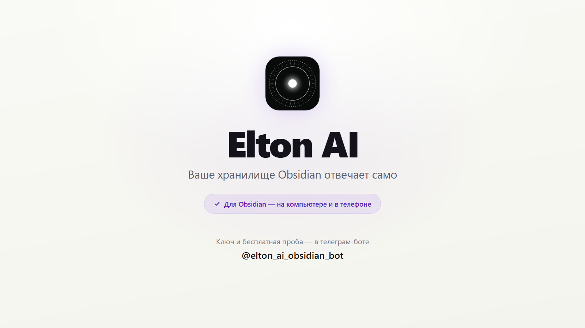

### ▶ Две минуты того, как это работает

[](https://www.youtube.com/watch?v=UHazxHln1aM)

*[Общаюсь со ВТОРЫМ мозгом как с ChatGPT — Obsidian без синхронизации](https://www.youtube.com/watch?v=UHazxHln1aM)* — живое хранилище, живой телефон, без ускорений.

|  |  |
| --- | --- |
| 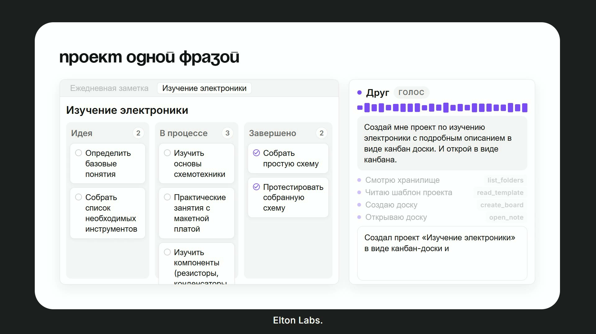 | 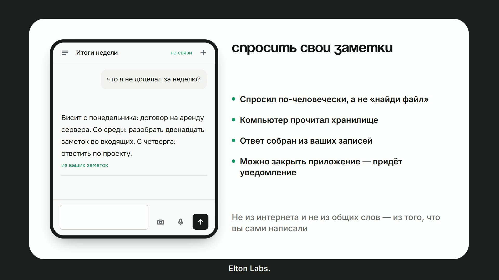 |
| **Проект одной фразой** — говорите, что нужно, и получаете настоящую канбан-доску, собранную по вашему шаблону и открытую перед вами. | **Спросить свои заметки** — по-человечески, а не «найди файл». Ответ собран из того, что вы написали, а не из интернета. |
| 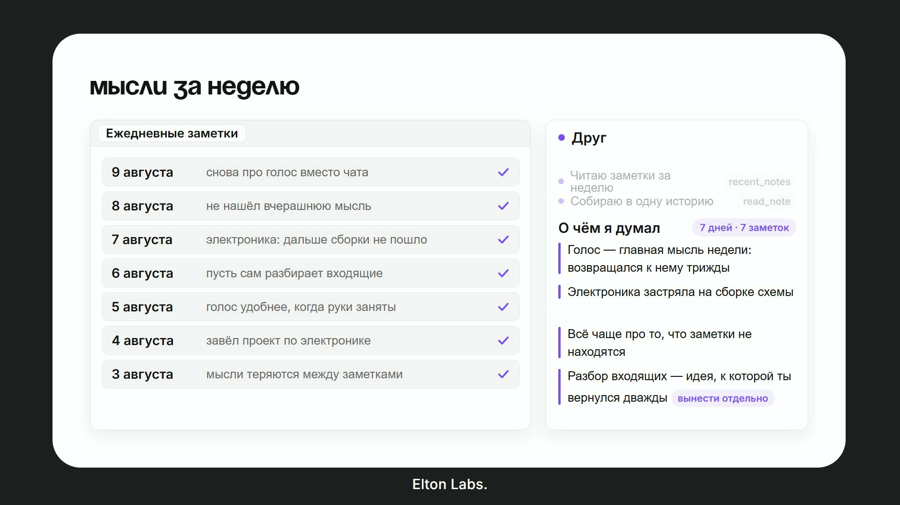 | 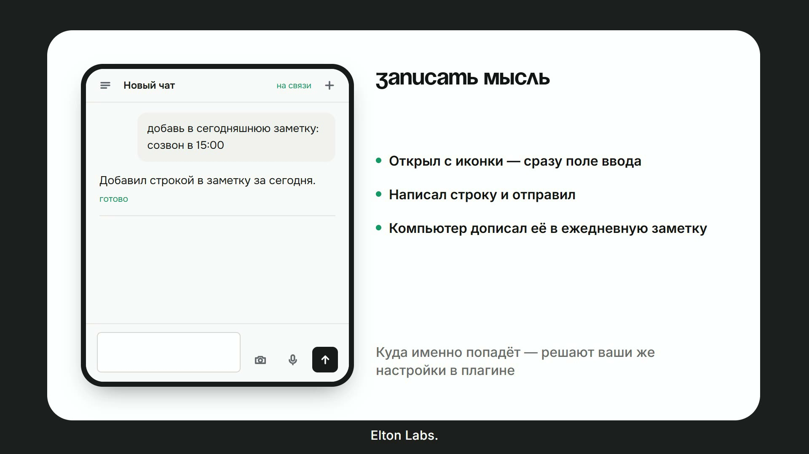 |
| **Моя неделя в мыслях** — он перечитывает ежедневные заметки и говорит, к чему вы возвращались чаще всего. | **Записать мысль** — строчка с телефона ложится в сегодняшнюю заметку. Куда именно — решают ваши настройки. |
| 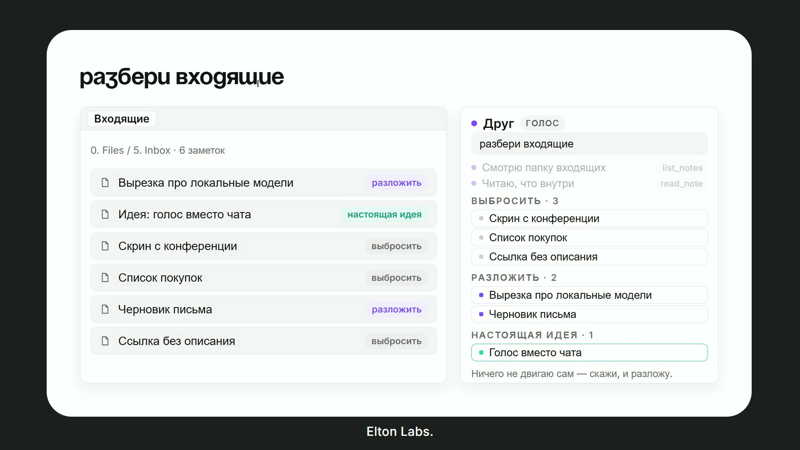 | 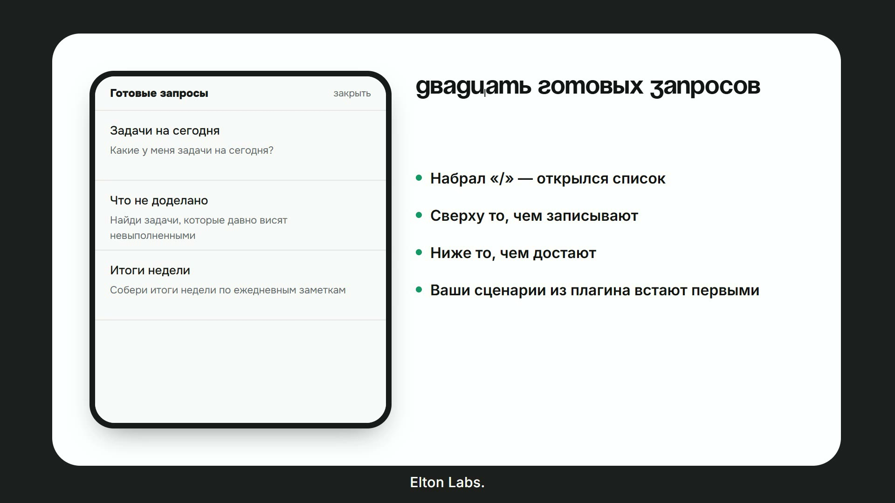 |
| **Разобрать входящие** — предлагает папку каждой бесхозной заметке и не двигает ничего, пока вы не скажете. | **Готовые запросы** — набираете `/` и выбираете. Ваши сохранённые задания идут первыми, двадцать полезных — за ними. |
| 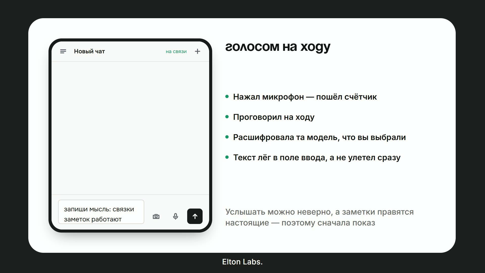 | 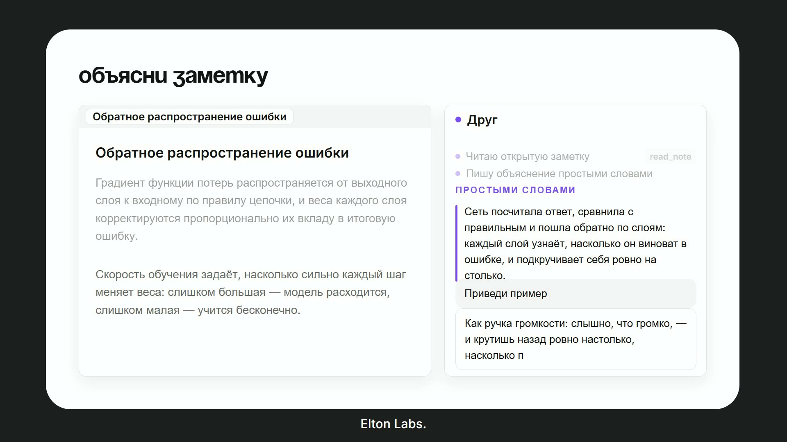 |
| **Голосом на ходу** — зажали, сказали, и расшифровка попадает в поле ввода до отправки: ослышался — правите вы. | **Объясни эту заметку** — отвечает про ту заметку, что перед вами, простыми словами, и приведёт пример, если попросить. |
| 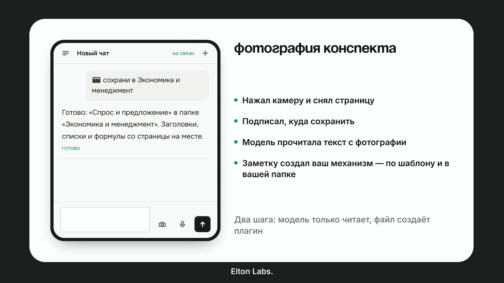 | 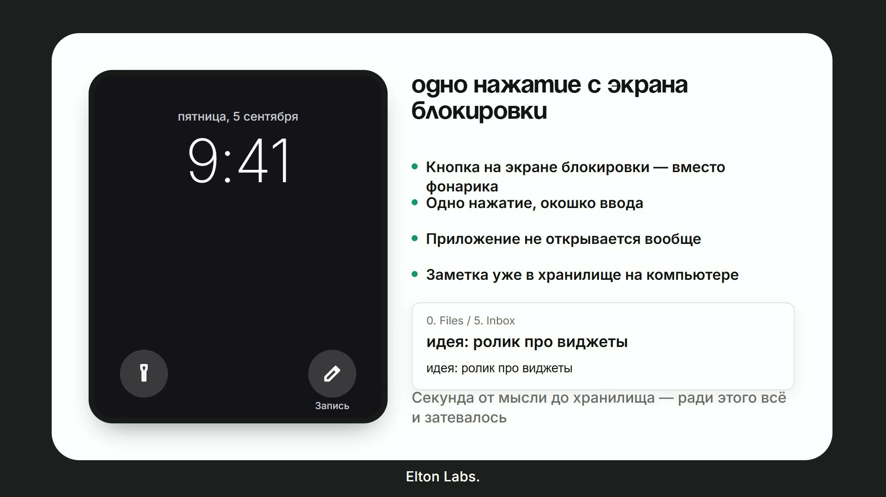 |
| **Фотография конспекта** — сфотографировали страницу, сказали куда, и заметка создана по вашему шаблону. | **Одно нажатие с локскрина** — ключ только на запись, для кнопки, которая умеет создать заметку и больше ничего. |

---

## Что умеет

**Отвечает из вашего хранилища.** Поиск по словам и, если включить, поиск по
смыслу через индекс эмбеддингов. Читает открытую заметку, ежедневные, папку,
отрезок дней. Если не нашёл — говорит, что не нашёл, а не придумывает. А на
вопрос про мир, а не про ваши записи, просто отвечает — и показывает, где это
смыкается с тем, что у вас записано.

**Пишет и раскладывает.** Новые заметки по вашим шаблонам, в ту папку, которой
хранилище для них и пользуется. Дописывает строку под заголовок. Правит заметку
на месте. Собирает канбан-доски и Bases, которые действительно рисуются. Ничего
не удаляет, не спросив.

**Голос в обе стороны.** Зажали клавишу и говорите — или разговор без рук.
Распознавание через вашего провайдера, озвучка через облачный голос или
локальный Piper: тогда хранилище говорит, ничего не отправляя наружу.

**Задания и автоматизации.** Сохранённый запрос за фразой («о чём я думал») или
за временем суток. Результат ложится в заметку, в уведомление, в Telegram или в
приложение.

**Мозги на ваш выбор.** Elton AI, OpenRouter, OpenAI напрямую или локальная
модель в Ollama / LM Studio. Ключ ваш — плагин держит его в этом хранилище и
больше нигде.

---

## Приложение на телефоне

Главное в версии 3.0. На вкладке «Коннектор» появляется код; вводите его один
раз в приложении — и всё хранилище с вами: спросить, надиктовать заметку,
дописать строку в сегодняшнюю. Приложение ставится на домашний экран прямо из
браузера по адресу [app.eltonlabs.org](https://app.eltonlabs.org): ни магазина
приложений, ни учётной записи.

**Отвечает не сервер, а ваш компьютер** — потому заметки и не уезжают никуда.
Отсюда единственное условие: компьютер включён, Obsidian открыт, коннектор
включён. Пока компьютер спит, приложение покажет, что связи нет; всё
отправленное дождётся в очереди и уедет, как только он вернётся.

Телефон и компьютер договариваются об общем секрете между собой
(ECDH P-256 → HKDF → AES-GCM), поэтому посредник несёт текст, который не может
прочитать.

Как подключить, по шагам и с коротким видео на каждый шаг:
**[eltonlabs.org/elton-ai-app](https://eltonlabs.org/elton-ai-app)**

---

## Установка

Настройки → Сторонние плагины → Обзор → в поиске **Elton AI** → Установить →
Включить. Если сверху висит «Ограниченный режим» — сначала выключите его: пока
он включён, Obsidian не даёт работать ни одному стороннему плагину.

При первом запуске откроется пошаговая настройка. Её всегда можно вызвать
заново: Настройки → Elton AI → **Открыть пошаговую настройку**.

### Бета-версии, через BRAT

1. Поставьте **BRAT** из списка сторонних плагинов.
2. BRAT → *Add Beta Plugin* → `swayinfo/elton-ai`
3. Включите **Elton AI** в списке сторонних плагинов.

### Вручную

Скачайте `main.js`, `manifest.json` и `styles.css` со
[страницы релизов](https://github.com/swayinfo/elton-ai/releases/latest) в
`<ваше хранилище>/.obsidian/plugins/elton-ai/` и перезапустите Obsidian.

---

## Про открытый код

**Плагин лежит здесь, открытым** — каждая строка, которая работает внутри вашего
Obsidian, находится в `src/`, а `main.js` в каждом релизе собирается из него
воркфлоу этого репозитория, с подтверждённым происхождением сборки. Читайте,
форкайте, собирайте сами, проверяйте, что уходит наружу.

Чего в открытом виде нет — так это релея, с которым говорит приложение, и это
осознанно, а не из скрытности. Релей существует потому, что сервера почти ни у
кого нет: без него понадобился бы публичный адрес для вашего компьютера,
сертификат и открытый порт — этого нельзя требовать от человека, который просто
хочет записать строчку из автобуса. Держать релей — это услуга, работа почтальона
и не больше, и она бесплатная. Он несёт шифр, который не может прочитать, держит
сообщение не дольше трёх суток и заметок не хранит вовсе: всё, что через него
проходит, перечислено в [разделе о приватности](#приватность-и-внешние-сервисы).

Если не хочется зависеть ни от кого — плагин полностью работает и без релея:
панель, голос, задания и локальная модель в Ollama не требуют сети совсем.

---

## Приватность и внешние сервисы

### Личные папки

Чтобы ответить, ассистент отправляет провайдеру куски ваших заметок. Поэтому есть список папок, которые он не трогает никогда: **Настройки → Хранилище → Что ему можно → Личные папки**.

Что значит «никогда»: такие заметки не читаются, не находятся поиском, не попадают в индекс, не уходят провайдеру — и не подставляются как «заметка на экране», даже если она открыта прямо сейчас. Проверка стоит перед всеми остальными и не зависит от области работы: в режиме «всё хранилище» личные папки всё равно закрыты. Вложенные папки закрыты вместе с родительской.

Сюда стоит положить медицину, финансы, пароли, сведения о других людях и всё, что вы обязались не разглашать.

Это не то же самое, что «где ему работать». Область работы отвечает на вопрос «в какой части хранилища он живёт изо дня в день» и имеет три взаимоисключающих режима — сказать ими «работай везде, кроме медкарты» нельзя. Личные папки отвечают на другой вопрос и действуют поверх области.

Отдельно есть список **«Не индексировать»** — обещание послабее: такие заметки ассистент откроет, если попросить по имени, но они не уезжают пачкой при построении индекса. Годится для большого архива, который не хочется оплачивать, не меньше, чем для деликатного.

### Куда уходят запросы

Плагин ходит к провайдеру, которого вы выбрали в настройках, и — только если вы сами их включили — к боту и к коннектору. Своего ключа в нём нет, скрытых адресов тоже: список исчерпывающий.

| Адрес | Когда используется | Что уходит |
|---|---|---|
| `api.eltonlabs.org` | провайдер **Elton AI** | текст запроса, найденные фрагменты заметок, аудио вашей реплики для распознавания |
| `openrouter.ai` | провайдер **OpenRouter** и веб-поиск | то же самое |
| `api.openai.com` | провайдер **OpenAI** | то же самое |
| `localhost:11434` | локальная модель (Ollama / LM Studio) | ничего не покидает компьютер |
| `localhost:5000` | локальный голос Piper | только текст ответа, для озвучки |
| `api.telegram.org` | только если вы подключили бота | ваши сообщения боту и ответы ассистента |
| `media.giphy.com` | только гифка ожидания в Telegram, один раз | ничего — просто скачивается картинка |
| `app.eltonlabs.org` | только если вы включили **коннектор** | ваши сообщения из приложения и ответы ассистента — под сквозным шифром, посредник несёт текст, который не может прочитать. Кроме этого — ваш ключ Elton AI, раз в несколько часов: код подключения закрепляется только по действующему ключу, иначе чужое хранилище открывалось бы по придуманным двенадцати знакам. Сам ключ на сервере не хранится |
| `relay.eltonlabs.org` | то же самое, запасной адрес | то же самое |
| `base.eltonlabs.org` | только при пополнении баланса из приложения | сумма и ваш ключ, в ответ приходит ссылка на оплату |
| `api.eltonlabs.org/skills` | только с провайдером Elton AI | ничего не отправляется; скачиваются короткие справки по форматам самого Obsidian, чтобы ассистент писал канбан-доску или Base, которые действительно рисуются |

Elton AI — собственный сервис автора для тех, кому не хочется сначала заводить где-то аккаунт и ключ: один баланс, пополняется из телеграм-бота, без карты у зарубежного провайдера и без отдельной регистрации. Есть бесплатный пробный доступ, чтобы посмотреть, подходит ли вам всё это, — промокод `Подарок`. Сколько стоит, какие модели доступны и как пополнять — на **[eltonlabs.org/elton-ai](https://eltonlabs.org/elton-ai)**. Этим же оплачивается работа над плагином. Любой другой провайдер работает без него, и плагин от этого ничего не теряет.

**Две вещи, которые проверка каталога отмечает у любого такого плагина — говорю прямо.** Плагин запрашивает у Obsidian список файлов хранилища: без этого поиск невозможен в принципе. Но попасть в список — не то же самое, что быть прочитанным: содержимое открывается, только когда оно нужно для ответа, а личные папки не попадают даже в сам список. И он пишет в системный буфер обмена — для кнопок «копировать» под ответом и под результатом автоматизации. Читать буфер он не умеет.

**Ни телеметрии, ни самообновления.** Плагин ничего не собирает о вас, не считает статистику и не отправляет аналитику никуда. Он не докачивает ни код, ни зависимости, ни собственные обновления — новые версии приходят из каталога или из BRAT, как у любого плагина. Справки, упомянутые выше, — это текст для модели, а не код, и свои копии плагин несёт в себе; сервис их только дополняет.

Заметки остаются в вашем хранилище. Провайдеру уходит только текст, нужный для ответа на конкретный вопрос: найденные фрагменты, открытая заметка и заметка с контекстом.

Ключи хранятся в `data.json` внутри папки плагина открытым текстом — так устроены все плагины Obsidian. Не держите ключи в хранилище, которым делитесь публично.

С локальной моделью в сеть не уходит ничего.

---

## Что нового в 3.0

**Приложение на телефоне.** То, ради чего версия и вышла — см. выше.

**Кнопка для одной мысли.** Отдельный ключ только на запись, для кнопки на
локскрине. Он умеет создать заметку и больше ничего: не читает, не правит, не
удаляет.

**Сквозное шифрование.** Телефон и этот компьютер договариваются об общем
секрете между собой; посредник несёт текст, который не может прочитать.

**Умеет прочитать фотографию.** Сфотографировали страницу конспекта, сказали
куда — и заметка написана по вашему шаблону. Латинские сокращения остаются
латиницей, а неразобранное помечается, а не угадывается.

**Голос на провайдере OpenAI снова работает.** Распознавание у него живёт не там,
где чат-модели, и запрос теперь собирается под тот адрес. Остальных провайдеров
это не касалось.

**Поисковый индекс сам говорит, что отстал.** Раз в неделю и только когда
заметок вне него накопилось достаточно.

**На вопрос про мир приходит ответ.** Спросили, что такое прибор — он объяснит,
а не пойдёт искать это слово по вашим заметкам и сообщать, что не нашёл. И
покажет, где это смыкается с вашими записями.

---

## Сборка из исходников

`main.js` собирается из файлов в `src/` простой склейкой, в том порядке, который
перечислен в `build.sh` — ни сборщика, ни шага, которому надо доверять.

```sh
sh build.sh      # соберёт main.js
npm run lint     # те же проверки, что гоняет сканер каталога
npm test         # 446 проверок
```

`deploy.sh` копирует три файла, которые читает Obsidian, в хранилище на ваш
выбор; путь задаётся через `VAULT_PLUGIN_DIR` или файл `.vault-path`.

---

## Лицензия

MIT — см. [LICENSE](LICENSE).
