# 🧠 Elton AI

**An assistant that lives in your Obsidian vault — and goes everywhere with you.**
Ask it anything about your own notes, dictate a thought, photograph a page,
plan a project: it answers from what *you* wrote and files new notes the way
*you* file them. The same assistant on your computer, on your phone and in
Telegram — and it remembers the conversation.

**[Русский](#-elton-ai-по-русски) · English** · desktop and mobile · open source · MIT

> **Try it free:** open [@elton_ai_obsidian_bot](https://t.me/elton_ai_obsidian_bot),
> press Start — that is your key. Promo code **Gift** gives you credits to try
> everything. Or bring your own key from OpenAI or OpenRouter, or run a local model
> in Ollama: the plugin takes any of them.


---

## One assistant, three places

| In Obsidian | On your phone | In Telegram |
| --- | --- | --- |
| A panel beside your notes. Type, or hold a key and talk — it answers out loud. It sees the note you have open. | An app that installs from the browser: a **feed** of your own notes, your **folders** exactly as on the computer, and **chats** with the assistant. | A bot in your own Telegram. Ask on the go, get a formatted answer, send a voice message. |

Your notes never move to a server. The phone asks, **your computer answers**, and
everything in between is end-to-end encrypted.

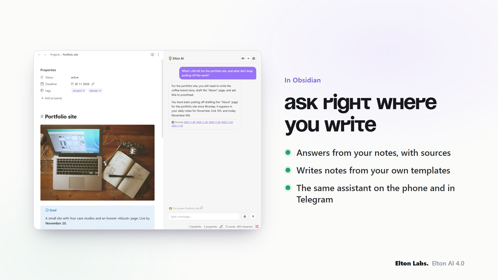

---

## What it is good at

**Asking your own notes.** *"What did I decide about the flat in March?"*,
*"What have I been thinking about this week?"* — it searches by words and by
meaning, reads what it finds and answers from it. Asked about the world rather than
your notes, it simply answers — and points at where your notes touch the subject.

**Search by meaning, set up in the welcome.** Ask about *"burnout"* and it finds the
note that says *"I have nothing left in the tank"*. The welcome has a step for it, so
nobody has to go looking: one pass over your notes, a fraction of a cent each, then
new and changed notes join the index by themselves. A vault of 10–20 thousand
notes takes about a quarter of an hour instead of an evening, and an interrupted
pass picks up where it stopped.

**Your notes as a feed.** On the phone the first tab is your own vault, one note per
screen — swipe up for the next, the way you scroll TikTok. Each note comes with its
picture; from there you can read it whole, ask about it or take it into a chat.

**Writing things down, properly.** *"Take down a thought: …"* — and every next
message, with no instruction, goes into the same note. New notes come out of
**your templates**, land in **your folders** and carry **your properties**, so they
look like the ones you wrote by hand.

**Turning a sentence into structure.** *"A project to learn ESP32"* becomes a real
Kanban board, filled with the actual steps. *"Sort my inbox"* proposes a folder for
every loose note and moves nothing until you say so.

**A photo, done your way.** Into today's note as a picture, as text read off a page
of handwriting, or *"what is this?"* — you choose on the phone before sending.

**Routines.** A long brief behind a short phrase (*"wrap up the day"*), or behind a
time of day (a morning digest that lands in a note, in Telegram or in the app).

**Voice both ways.** Hold a key anywhere in Obsidian and speak. Answers are read
aloud by a cloud voice or a local Piper — or stay silent if you prefer text.

|  |  |
| --- | --- |
| 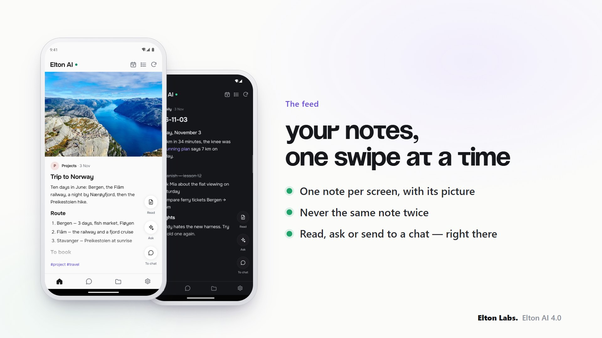 | 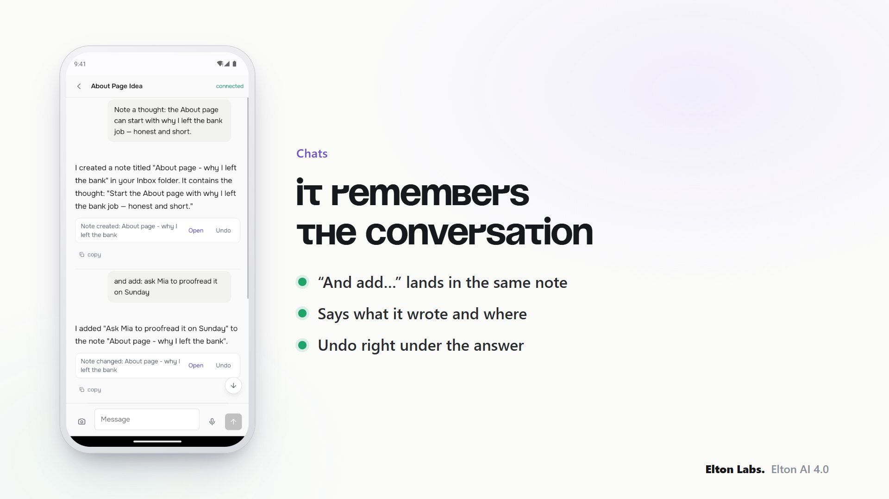 |
| 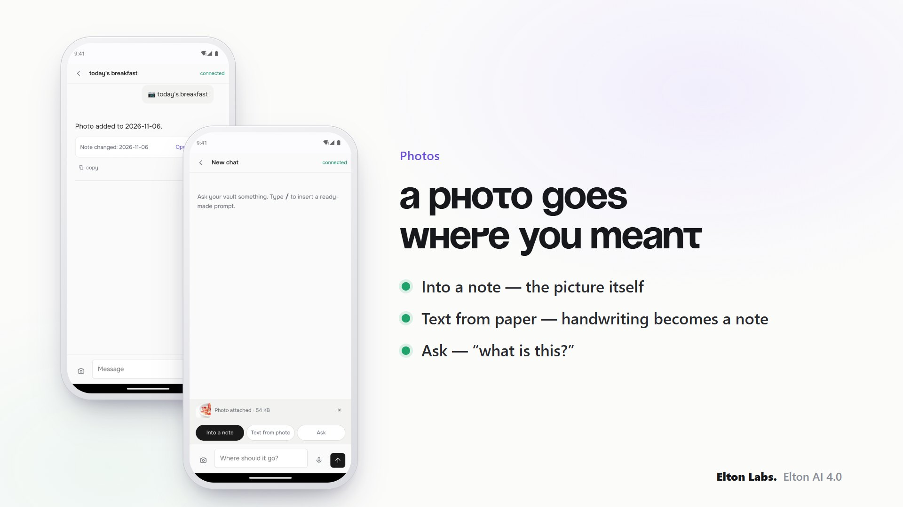 | 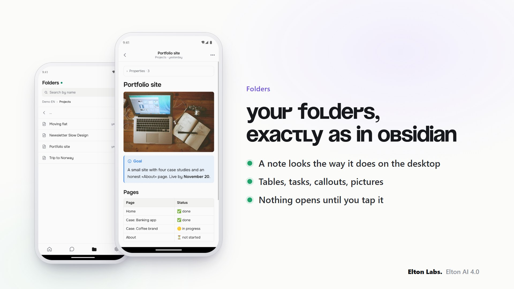 |
| 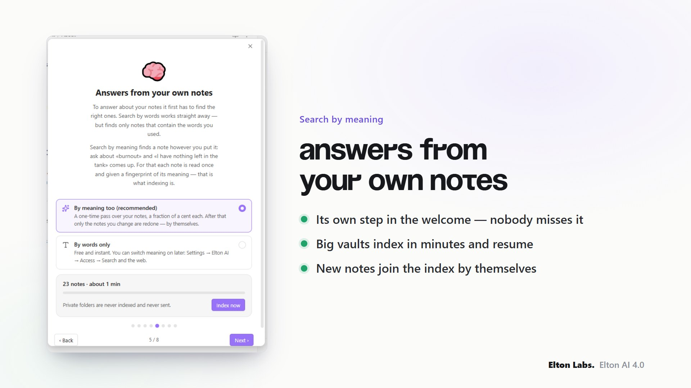 | 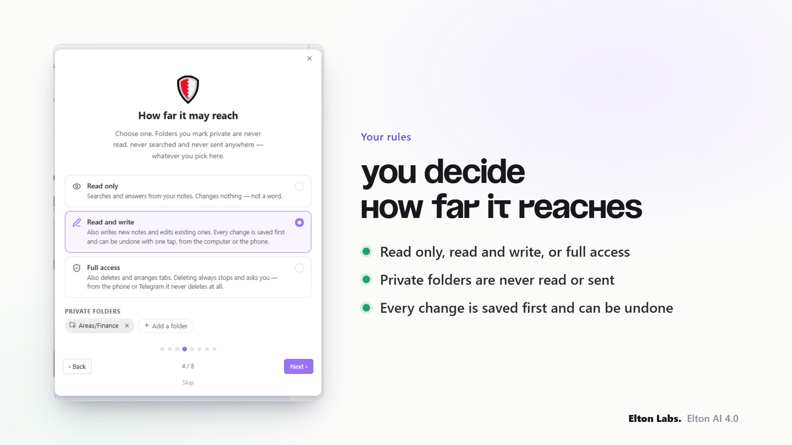 |

---

## Can I trust it with my notes?

The fair question, and the answer is built in rather than promised:

- **Three levels of access**, chosen in one tap: *read only*, *read and write*,
  *full*. A switched-off permission is not a request the AI is asked to respect —
  the tool simply does not exist for it.
- **Private folders** — health, money, other people's details — are never read,
  never searched, never indexed and never sent, even when the note is open on
  your screen.
- **Every change can be undone.** Each note the assistant creates or edits is saved
  first. Undo it from the answer itself, from the phone, or from the list of
  changes in the settings — the note goes back exactly as it was.
- **It never deletes on its own.** Deleting always stops and asks you at the
  keyboard; from the phone or Telegram it does not delete at all.
- **No telemetry, no hidden addresses.** Every address the plugin can contact is
  listed [below](#privacy-and-external-services). With a local model nothing leaves
  your machine at all.

---

## Get started in two minutes

1. Settings → Community plugins → Browse → **Elton AI** → Install → Enable.
2. A short welcome opens: pick where answers come from, paste the key, choose how
   far it may reach. It can be reopened any time on **Settings → Elton AI → Home**.
3. Open the panel from the ribbon and ask something. For the phone, switch on
   **Settings → Elton AI → Phone** and type the code once in the app at
   [app.eltonlabs.org](https://app.eltonlabs.org).

---

## What's new in 4.0

- **A feed like TikTok** — one note per screen, swipe for the next, never the same
  note twice. Prefer a list? One tap switches.
- **It remembers the conversation** — on the phone and in Telegram too, across
  restarts. A message that never reached the computer is picked up from the phone.
- **A new phone app** — Feed, Chats, Folders and Settings at the bottom, like any
  app. Notes open looking the way they do in Obsidian: callouts, tasks, tables,
  links you can follow, pictures.
- **Photos do what you choose** — into a note, as text, or a question.
- **Every change can be undone** — from the answer, the phone or the settings.
- **Search by meaning for everyone** — its own step in the welcome; indexing is many
  times faster, saves as it goes, resumes, and keeps itself up to date.
- **Daily notes named your way** — DD-MM-YYYY, YYYY-MM-DD, with weekdays or folders:
  the format comes from Obsidian's Daily notes or Periodic Notes settings.
- **Simpler settings** — a Home tab with the state of everything, three levels of
  access, folders picked from a list.

---

## Something not working? An idea?

Write to the Telegram bot **[@elton_feedback_bot](https://t.me/elton_feedback_bot)** —
complaints, ideas and "this does not work" all go there. A plain message is enough,
a screenshot helps, and every message is read. The link is also on
**Settings → Elton AI → Home** and in the phone app's settings.

---

## Install

Settings → Community plugins → Browse → search for **Elton AI** → Install →
Enable. If *Restricted mode* is on at the top of that page, turn it off first —
while it is on, Obsidian runs no community plugin at all.

The welcome opens the first time you run it, and can be reopened any time
from Settings → Elton AI → **Home** → **Welcome tour**.

### Beta versions, with BRAT

1. Install **BRAT** from the community plugins list.
2. BRAT → *Add beta plugin* → `swayinfo/elton-ai`
3. Enable **Elton AI** in Community plugins.

### By hand

Download `main.js`, `manifest.json` and `styles.css` from the
[latest release](https://github.com/swayinfo/elton-ai/releases/latest) into
`<vault>/.obsidian/plugins/elton-ai/`, then reload Obsidian.

---

## Open source

**The plugin is here, in the open** — every line that runs inside your Obsidian
is in `src/`, and `main.js` in each release is built from it by the workflow in
this repository, with build provenance attested. Read it, fork it, build it
yourself, check what it sends.

What is *not* published is the relay the app talks to, and that is deliberate
rather than coy. The relay exists because almost nobody has a server: without it
you would need a public address for your own computer, a certificate and an open
port, which is not a thing to ask of someone who just wants to write a line from
the bus. Running it is a service — a postman, nothing more — and it is free to
use. It carries ciphertext it cannot read, keeps a message for at most three days
and stores no notes at all: the [privacy section](#privacy-and-external-services)
lists everything that crosses it.

If you would rather depend on nobody, the plugin is fully usable without the
relay: the panel, the voice, the tasks and a local model in Ollama need no
network at all.

---

## Who makes this

I'm Elton. I work where marketing, AI and knowledge systems meet, and I have
been building in digital for six years — the long version, with the numbers, is
on **[eltonlabs.org/en/about](https://eltonlabs.org/en/about)**.

Why that matters for a plugin that asks for a key and reads your notes: you are
trusting a person, so here is where to check them.

- **Two plugins in Obsidian's official catalogue**, reviewed by its maintainers,
  not side-loaded: this one and
  **[Book Reader](https://github.com/swayinfo/elton-reader)**. Both are listed in
  [community-plugins.json](https://github.com/obsidianmd/obsidian-releases/blob/master/community-plugins.json)
  under `swayinfo`.
- **A YouTube channel** the plugin grew out of —
  **[@Elton_Labs](https://www.youtube.com/@Elton_Labs)** — where every feature
  here has been shown running, on camera, before it shipped.
- **A community that answers** — the Obsidian & Mind Club, and a Telegram
  channel at **[@eltonlabs](https://t.me/eltonlabs)**. Bugs get answered by me,
  not by a form.
- **A real address and a real name** on the site, on the invoice and in the
  plugin's own settings. Not a handle.

If something here breaks, you know who to ask, and I am easy to find.

---

## Privacy and external services

### Private folders

Answering a question sends parts of your notes to your provider. So there is a list of folders it never touches: **Settings → Elton AI → Access → Private folders**.

"Never" means: not read, not found by search, not indexed, not sent — and not offered as "the note on screen" even when it is open in front of you. The check runs before every other one and does not depend on the working scope: in "whole vault" mode private folders are still closed. Subfolders are closed with their parent.

This is where medical records, finances, passwords, other people's information and anything under an agreement belong.

It is not the same thing as "where it may work". The scope answers "which part of the vault does it live in day to day" and has three modes that exclude each other — there is no way to say "work everywhere except my medical notes" with it. Private folders answer a different question and apply on top of the scope.

There is also a weaker list, **"Left out of the index"**: those notes can still be opened when you ask for one by name, they are simply never sent away in bulk when the index is built. As useful for a large archive you would rather not pay to embed as for anything delicate.

### Where requests go

The plugin contacts the provider you chose in settings, and — only if you switched them on yourself — the bot and the connector. It carries no key of its own and no hidden addresses; this list is exhaustive.

| Address | When it is used | What is sent |
|---|---|---|
| `api.eltonlabs.org` | the **Elton AI** provider | the request, the note fragments found for it, and the audio of what you said, for transcription |
| `openrouter.ai` | the **OpenRouter** provider and web search | the same |
| `api.openai.com` | the **OpenAI** provider | the same |
| `localhost:11434` | a local model (Ollama / LM Studio) | nothing leaves the machine |
| `localhost:5000` | the local Piper voice | only the answer text, to be spoken |
| `api.telegram.org` | only if you connected a bot | your messages to the bot and the assistant's replies |
| `media.giphy.com` | only the Telegram waiting animation, once | nothing — a picture is downloaded |
| `app.eltonlabs.org` | only if you switched the **connector** on | your messages from the app and the assistant's replies, and the notes, folder names and pictures you open in the app's feed and folders — all encrypted end to end, so the relay carries text it cannot read, and a note you opened is deleted from it the moment the phone has it. Besides those, your Elton AI key, once every few hours: a connection code is only claimed against a working key, or anyone could reach a vault by inventing twelve characters. The key itself is not stored on the server |
| `relay.eltonlabs.org` | the same, as a fallback address | the same |
| `base.eltonlabs.org` | only when you top the balance up from the app | the amount and your key, to get a payment link back |
| `api.eltonlabs.org/skills` | only with the Elton AI provider | nothing is sent; short guides to Obsidian's own file formats are fetched, so the assistant writes a Kanban board or a Base that actually renders |

Elton AI is the author's own service, for people who would rather not set up an account and a key somewhere first: one balance, topped up from a Telegram bot, no card details left with a foreign provider and no separate signup. There is a free trial to see whether the whole thing suits you — promo code `Gift` — and what it costs, which models it covers and how to top it up is on **[eltonlabs.org/en/elton-ai](https://eltonlabs.org/en/elton-ai)**. Using it is also what pays for this plugin being worked on. Every other provider works without it and the plugin loses nothing.

**Two things the catalogue's review flags for any plugin like this, spelled out.** The plugin asks Obsidian for the list of files in the vault — that is what makes search possible at all — but a file being listed is not a file being read: contents are only opened when a question needs them, and private folders are excluded from the list itself. And it writes to the system clipboard, for the "copy" buttons under an answer and under an automation's result. It never reads the clipboard.

**No telemetry, and no self-updating.** The plugin collects nothing about you, keeps no statistics, and sends no analytics anywhere. It does not download code, dependencies or updates of itself — new versions come from the community catalogue or from BRAT, like any other plugin. The guides mentioned above are plain text for the model to read, not code, and the plugin ships with its own copies built in; the service only adds to them.

Requests to a provider are seen by that provider, as with any API — that is true of OpenAI and OpenRouter as much as of Elton AI, which keeps no copies of your notes. If you would rather not rely on someone else's service at all, use your own key or a local model, and the author's service is never contacted.

Your notes stay in your vault. Only the text needed to answer the question at hand is sent: the fragments found, the note on screen, and the context note.

Keys are stored in `data.json` inside the plugin's folder as plain text — that is how every Obsidian plugin works. Do not keep keys in a vault you share publicly.

With a local model, nothing goes out at all.

---

## Building from source

`main.js` is assembled from the files in `src/` by concatenation, in the order
`build.sh` lists — no bundler, no build step to trust.

```sh
sh build.sh      # writes main.js
npm run lint     # the checks the community scanner runs
npm test         # 502 assertions
```

`deploy.sh` copies the three files Obsidian reads into a vault of your choice;
point it there with `VAULT_PLUGIN_DIR` or a `.vault-path` file.

---

## Licence

MIT — see [LICENSE](LICENSE).

---
---

---
---

# 🧠 Elton AI (по-русски)

**Ассистент, который живёт в вашем хранилище Obsidian — и ходит с вами везде.**
Спросите что угодно о своих заметках, надиктуйте мысль, сфотографируйте страницу,
задумайте проект — он отвечает из того, что написали *вы*, и раскладывает новые
заметки так, как раскладываете *вы*. Один и тот же ассистент на компьютере, на
телефоне и в Телеграме — и он помнит разговор.

**Русский · [English](#-elton-ai)** · компьютер и телефон · открытый код · MIT

> **Попробовать бесплатно:** откройте [@elton_ai_obsidian_bot](https://t.me/elton_ai_obsidian_bot),
> нажмите «Start» — это и есть ключ. Промокод **«Подарок»** даёт кредиты, чтобы
> попробовать всё. Или свой ключ от OpenAI, OpenRouter, локальная модель в Ollama —
> плагин работает с любым.

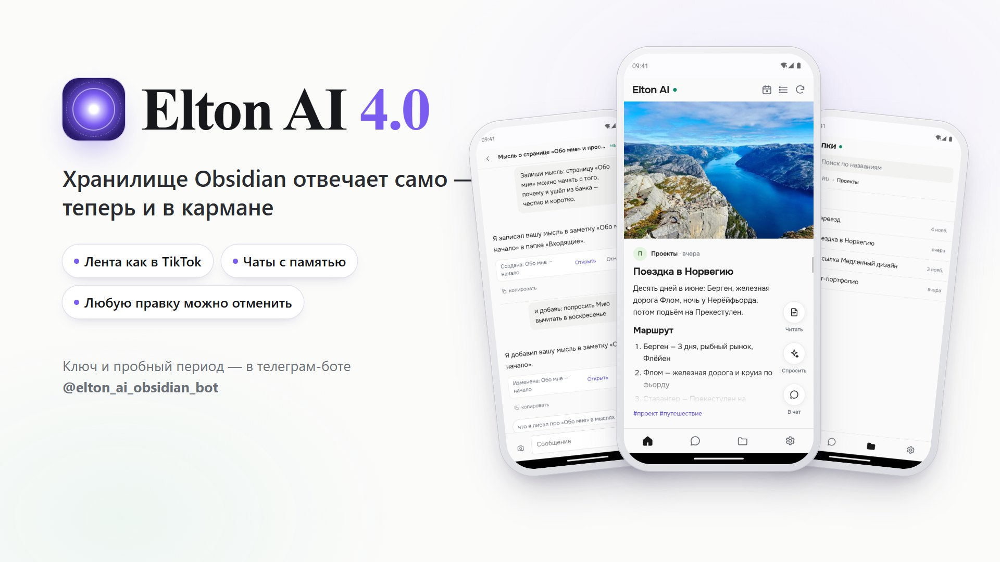

---

## Один ассистент — три места

| В Obsidian | На телефоне | В Телеграме |
| --- | --- | --- |
| Панель рядом с заметками. Пишите или зажмите клавишу и говорите — ответит вслух. Видит открытую заметку. | Приложение, которое ставится из браузера: **лента** из ваших заметок, **папки** точно как на компьютере и **чаты** с ассистентом. | Бот в вашем Телеграме. Спросить на ходу, получить оформленный ответ, отправить голосовое. |

Заметки не переезжают на сервер. Телефон спрашивает — **отвечает ваш компьютер**,
а всё, что между ними, зашифровано из конца в конец.

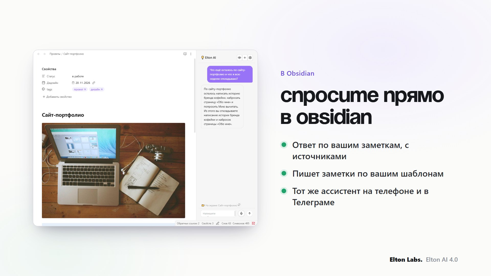

---

## Что он умеет лучше всего

**Спросить свои заметки.** «Что я решил про квартиру в марте?», «О чём я думал на
этой неделе?» — ищет по словам и по смыслу, читает найденное и отвечает из него.
Спросите о мире, а не о заметках, — просто ответит и покажет, где ваши заметки
этого касаются.

**Поиск по смыслу — прямо в приветствии.** Спросите про «выгорание» — найдётся
заметка, где написано «сил больше нет совсем». В приветствии для этого отдельный шаг,
искать настройку не нужно: один проход по заметкам, доли копейки за каждую, дальше
новые и изменённые заметки попадают в индекс сами. Хранилище на 10–20 тысяч заметок
индексируется примерно за четверть часа, а не за вечер, а прерванный проход
продолжается с того же места.

**Заметки лентой.** На телефоне первая вкладка — ваше собственное хранилище, одна
заметка на экран: свайп вверх — следующая, как в TikTok. Каждая — со своей картинкой;
отсюда её можно открыть целиком, спросить о ней или забрать в чат.

**Записать по-настоящему.** «Запиши мысль: …» — и каждое следующее сообщение, без
всяких команд, ляжет в ту же заметку. Новые заметки — **по вашим шаблонам**, в
**ваши папки** и с **вашими свойствами**: выглядят так же, как написанные руками.

**Фраза — в структуру.** «Проект: выучить ESP32» превращается в настоящую
канбан-доску с реальными шагами. «Разбери входящие» — предложит папку каждой
бесхозной заметке и ничего не тронет, пока вы не скажете.

**Фото — куда скажете.** Картинкой в сегодняшнюю заметку, текстом с исписанной
страницы или «что это?» — выбираете на телефоне перед отправкой.

**Ритуалы.** Длинная просьба за короткой фразой («итоги дня») или за временем
(утренняя сводка — в заметку, в Телеграм или в приложение).

**Голос в обе стороны.** Зажмите клавишу в любом месте Obsidian и говорите. Ответы
читает облачный голос или локальный Piper — или молчит, если вам удобнее текст.

|  |  |
| --- | --- |
| 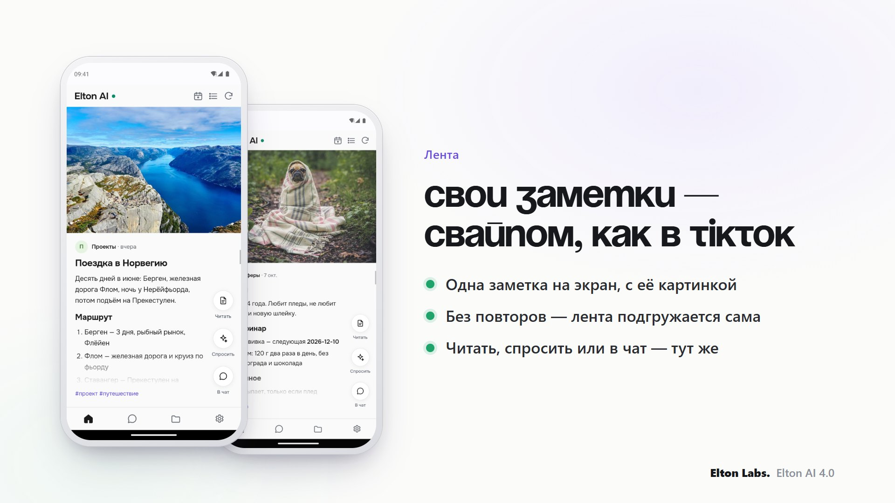 | 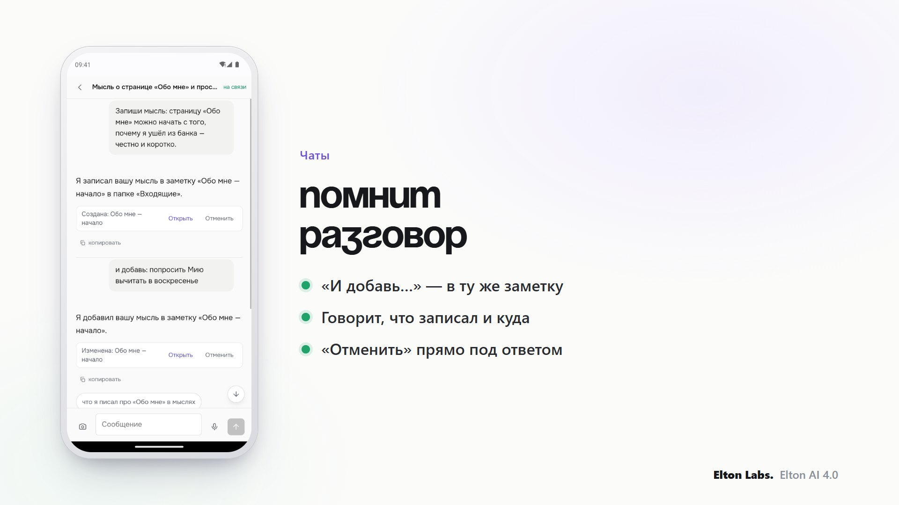 |
| 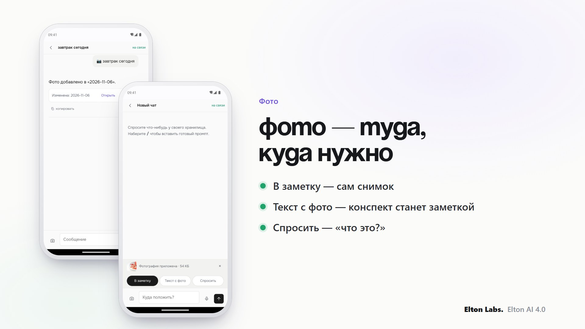 | 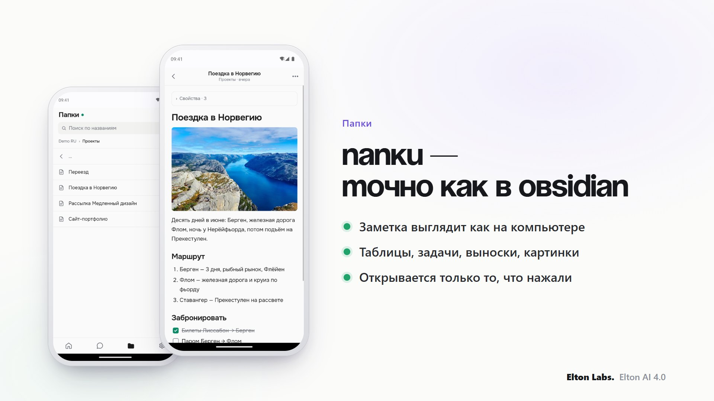 |
| 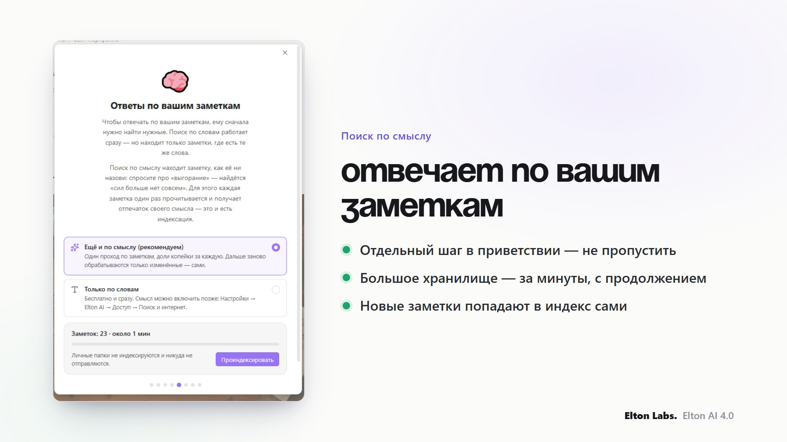 | 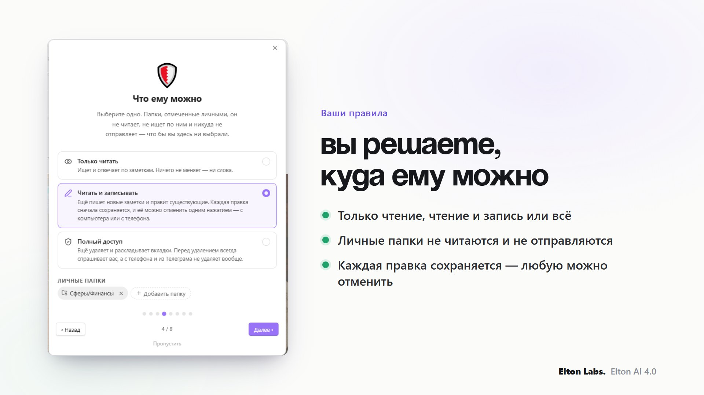 |

---

## Можно ли доверить ему заметки?

Честный вопрос. Ответ — не обещание, а устройство:

- **Три уровня доступа** одним нажатием: *только читать*, *читать и записывать*,
  *полный*. Выключенное разрешение — не просьба к ИИ: такого инструмента у него
  просто нет.
- **Личные папки** — здоровье, деньги, чужие данные — не читаются, не ищутся, не
  индексируются и никуда не отправляются, даже если заметка открыта у вас на экране.
- **Любую правку можно отменить.** Каждая заметка, которую ассистент создал или
  поправил, сначала сохраняется. Отменить можно прямо из ответа, с телефона или из
  списка изменений в настройках — заметка вернётся ровно такой, какой была.
- **Сам ничего не удаляет.** Удаление всегда останавливается и спрашивает вас за
  клавиатурой, а с телефона и из Телеграма не удаляет вообще.
- **Никакой телеметрии и скрытых адресов.** Все адреса, куда плагин может
  обратиться, перечислены [ниже](#приватность-и-внешние-сервисы). С локальной
  моделью наружу не уходит ничего.

---

## Начать за две минуты

1. Настройки → Сторонние плагины → Обзор → **Elton AI** → Установить → Включить.
2. Откроется короткое знакомство: откуда брать ответы, ключ, что ему можно. Его
   можно открыть снова в любой момент: **Настройки → Elton AI → Главная**.
3. Откройте панель значком на левой панели и спросите что-нибудь. Для телефона —
   включите **Настройки → Elton AI → Телефон** и один раз введите код в приложении
   на [app.eltonlabs.org](https://app.eltonlabs.org).

---

## Что нового в 4.0

- **Лента как в TikTok** — одна заметка на экран, свайп — следующая, без повторов.
  Удобнее списком — переключается одним нажатием.
- **Помнит разговор** — и на телефоне, и в Телеграме, даже после перезапуска.
  Сообщение, не дошедшее до компьютера, подхватывается с телефона.
- **Новое приложение на телефоне** — Лента, Чаты, Папки и Настройки внизу, как в
  любом приложении. Заметки открываются такими же, как в Obsidian: выноски,
  задачи, таблицы, ссылки, по которым можно перейти, картинки.
- **Фото — куда выберете** — в заметку, текстом или вопросом.
- **Любую правку можно отменить** — из ответа, с телефона или в настройках.
- **Поиск по смыслу — для всех** — отдельный шаг в приветствии; индексация в разы
  быстрее, сохраняется по ходу, продолжает с места остановки и обновляется сама.
- **Ежедневные заметки — как названы у вас** — ДД-ММ-ГГГГ, ГГГГ-ММ-ДД, с днём недели
  или по папкам: формат берётся из настроек «Ежедневных заметок» или Periodic Notes.
- **Настройки проще** — вкладка «Главная», где видно всё сразу, три уровня
  доступа, папки выбираются из списка.

---

## Что-то не работает? Есть идея?

Пишите в телеграм-бот **[@elton_feedback_bot](https://t.me/elton_feedback_bot)** —
жалобы, идеи и «это не работает», всё туда. Обычного сообщения достаточно, скриншот
поможет, читаем каждое. Ссылка есть и в **Настройки → Elton AI → Главная**, и в
настройках приложения на телефоне.

---

## Установка

Настройки → Сторонние плагины → Обзор → в поиске **Elton AI** → Установить →
Включить. Если сверху висит «Ограниченный режим» — сначала выключите его: пока
он включён, Obsidian не даёт работать ни одному стороннему плагину.

При первом запуске откроется пошаговая настройка. Её всегда можно вызвать
заново: Настройки → Elton AI → **Главная** → **Знакомство**.

### Бета-версии, через BRAT

1. Поставьте **BRAT** из списка сторонних плагинов.
2. BRAT → *Add Beta Plugin* → `swayinfo/elton-ai`
3. Включите **Elton AI** в списке сторонних плагинов.

### Вручную

Скачайте `main.js`, `manifest.json` и `styles.css` со
[страницы релизов](https://github.com/swayinfo/elton-ai/releases/latest) в
`<ваше хранилище>/.obsidian/plugins/elton-ai/` и перезапустите Obsidian.

---

## Про открытый код

**Плагин лежит здесь, открытым** — каждая строка, которая работает внутри вашего
Obsidian, находится в `src/`, а `main.js` в каждом релизе собирается из него
воркфлоу этого репозитория, с подтверждённым происхождением сборки. Читайте,
форкайте, собирайте сами, проверяйте, что уходит наружу.

Чего в открытом виде нет — так это релея, с которым говорит приложение, и это
осознанно, а не из скрытности. Релей существует потому, что сервера почти ни у
кого нет: без него понадобился бы публичный адрес для вашего компьютера,
сертификат и открытый порт — этого нельзя требовать от человека, который просто
хочет записать строчку из автобуса. Держать релей — это услуга, работа почтальона
и не больше, и она бесплатная. Он несёт шифр, который не может прочитать, держит
сообщение не дольше трёх суток и заметок не хранит вовсе: всё, что через него
проходит, перечислено в [разделе о приватности](#приватность-и-внешние-сервисы).

Если не хочется зависеть ни от кого — плагин полностью работает и без релея:
панель, голос, задания и локальная модель в Ollama не требуют сети совсем.

---

## Кто это делает

Меня зовут Элтон. Работаю на стыке маркетинга, ИИ и систем знаний, в digital
шесть лет — подробно и с цифрами на
**[eltonlabs.org/about](https://eltonlabs.org/about)**.

Почему это вообще важно для плагина, который просит ключ и читает ваши заметки:
вы доверяете человеку, поэтому вот где его можно проверить.

- **Два плагина в официальном каталоге Obsidian**, прошедшие проверку его
  сопровождающих, а не поставленные в обход: этот и
  **[Book Reader](https://github.com/swayinfo/elton-reader)**. Оба есть в
  [community-plugins.json](https://github.com/obsidianmd/obsidian-releases/blob/master/community-plugins.json)
  под `swayinfo`.
- **Ютуб-канал**, из которого плагин и вырос —
  **[@Elton_Labs](https://www.youtube.com/@Elton_Labs)**: каждая функция отсюда
  показана в работе, на камеру, до того как попала в релиз.
- **Сообщество, где отвечают** — «Obsidian & Mind Club» и телеграм-канал
  **[@eltonlabs](https://t.me/eltonlabs)**. На баг отвечаю я, а не форма.
- **Настоящий адрес и настоящее имя** — на сайте, в чеке и в самих настройках
  плагина. Не ник.

Если что-то сломается — понятно, кого спрашивать, и найти меня легко.

---

## Приватность и внешние сервисы

### Личные папки

Чтобы ответить, ассистент отправляет провайдеру куски ваших заметок. Поэтому есть список папок, которые он не трогает никогда: **Настройки → Elton AI → Доступ → Личные папки**.

Что значит «никогда»: такие заметки не читаются, не находятся поиском, не попадают в индекс, не уходят провайдеру — и не подставляются как «заметка на экране», даже если она открыта прямо сейчас. Проверка стоит перед всеми остальными и не зависит от области работы: в режиме «всё хранилище» личные папки всё равно закрыты. Вложенные папки закрыты вместе с родительской.

Сюда стоит положить медицину, финансы, пароли, сведения о других людях и всё, что вы обязались не разглашать.

Это не то же самое, что «где ему работать». Область работы отвечает на вопрос «в какой части хранилища он живёт изо дня в день» и имеет три взаимоисключающих режима — сказать ими «работай везде, кроме медкарты» нельзя. Личные папки отвечают на другой вопрос и действуют поверх области.

Отдельно есть список **«Не индексировать»** — обещание послабее: такие заметки ассистент откроет, если попросить по имени, но они не уезжают пачкой при построении индекса. Годится для большого архива, который не хочется оплачивать, не меньше, чем для деликатного.

### Куда уходят запросы

Плагин ходит к провайдеру, которого вы выбрали в настройках, и — только если вы сами их включили — к боту и к коннектору. Своего ключа в нём нет, скрытых адресов тоже: список исчерпывающий.

| Адрес | Когда используется | Что уходит |
|---|---|---|
| `api.eltonlabs.org` | провайдер **Elton AI** | текст запроса, найденные фрагменты заметок, аудио вашей реплики для распознавания |
| `openrouter.ai` | провайдер **OpenRouter** и веб-поиск | то же самое |
| `api.openai.com` | провайдер **OpenAI** | то же самое |
| `localhost:11434` | локальная модель (Ollama / LM Studio) | ничего не покидает компьютер |
| `localhost:5000` | локальный голос Piper | только текст ответа, для озвучки |
| `api.telegram.org` | только если вы подключили бота | ваши сообщения боту и ответы ассистента |
| `media.giphy.com` | только гифка ожидания в Telegram, один раз | ничего — просто скачивается картинка |
| `app.eltonlabs.org` | только если вы включили **коннектор** | ваши сообщения из приложения и ответы ассистента, а также заметки, названия папок и картинки, которые вы открываете в ленте и папках приложения, — всё под сквозным шифром: посредник несёт текст, который не может прочитать, а открытая заметка удаляется с него, как только телефон её получил. Кроме этого — ваш ключ Elton AI, раз в несколько часов: код подключения закрепляется только по действующему ключу, иначе чужое хранилище открывалось бы по придуманным двенадцати знакам. Сам ключ на сервере не хранится |
| `relay.eltonlabs.org` | то же самое, запасной адрес | то же самое |
| `base.eltonlabs.org` | только при пополнении баланса из приложения | сумма и ваш ключ, в ответ приходит ссылка на оплату |
| `api.eltonlabs.org/skills` | только с провайдером Elton AI | ничего не отправляется; скачиваются короткие справки по форматам самого Obsidian, чтобы ассистент писал канбан-доску или Base, которые действительно рисуются |

Elton AI — собственный сервис автора для тех, кому не хочется сначала заводить где-то аккаунт и ключ: один баланс, пополняется из телеграм-бота, без карты у зарубежного провайдера и без отдельной регистрации. Есть бесплатный пробный доступ, чтобы посмотреть, подходит ли вам всё это, — промокод `Подарок`. Сколько стоит, какие модели доступны и как пополнять — на **[eltonlabs.org/elton-ai](https://eltonlabs.org/elton-ai)**. Этим же оплачивается работа над плагином. Любой другой провайдер работает без него, и плагин от этого ничего не теряет.

**Две вещи, которые проверка каталога отмечает у любого такого плагина — говорю прямо.** Плагин запрашивает у Obsidian список файлов хранилища: без этого поиск невозможен в принципе. Но попасть в список — не то же самое, что быть прочитанным: содержимое открывается, только когда оно нужно для ответа, а личные папки не попадают даже в сам список. И он пишет в системный буфер обмена — для кнопок «копировать» под ответом и под результатом автоматизации. Читать буфер он не умеет.

**Ни телеметрии, ни самообновления.** Плагин ничего не собирает о вас, не считает статистику и не отправляет аналитику никуда. Он не докачивает ни код, ни зависимости, ни собственные обновления — новые версии приходят из каталога или из BRAT, как у любого плагина. Справки, упомянутые выше, — это текст для модели, а не код, и свои копии плагин несёт в себе; сервис их только дополняет.

Заметки остаются в вашем хранилище. Провайдеру уходит только текст, нужный для ответа на конкретный вопрос: найденные фрагменты, открытая заметка и заметка с контекстом.

Ключи хранятся в `data.json` внутри папки плагина открытым текстом — так устроены все плагины Obsidian. Не держите ключи в хранилище, которым делитесь публично.

С локальной моделью в сеть не уходит ничего.

---

## Сборка из исходников

`main.js` собирается из файлов в `src/` простой склейкой, в том порядке, который
перечислен в `build.sh` — ни сборщика, ни шага, которому надо доверять.

```sh
sh build.sh      # соберёт main.js
npm run lint     # те же проверки, что гоняет сканер каталога
npm test         # 502 проверки
```

`deploy.sh` копирует три файла, которые читает Obsidian, в хранилище на ваш
выбор; путь задаётся через `VAULT_PLUGIN_DIR` или файл `.vault-path`.

---

## Лицензия

MIT — см. [LICENSE](LICENSE).
