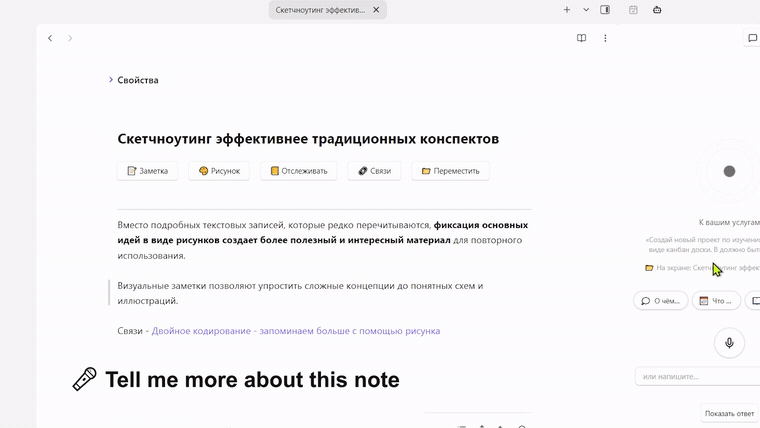

# Elton AI

*[English](README.md) · Русский · [eltonlabs.org/elton-ai](https://eltonlabs.org/elton-ai)*

Голосовой и текстовый ассистент, который работает с заметками, которые у вас уже есть. Он ищет по хранилищу, отвечает по нему, создаёт и правит заметки, раскладывает их по местам и показывает нужное на экране — голосом, текстом или с телефона через собственного телеграм-бота.



▶ **[Посмотреть полное двухминутное демо](docs/elton-ai-demo.mp4)**

Плагин не содержит своего ключа: запросы идут через того провайдера, которого вы выбрали. С локальной моделью данные не покидают компьютер вообще.

> [!IMPORTANT]
> **Плагин отправляет текст заметок во внешний сервис, и без учётной записи где-нибудь он не работает.**
>
> Чтобы ответить, он отправляет те фрагменты ваших заметок, которые нужны для ответа, — а в голосовом режиме ещё и запись вашей реплики — тому из четырёх, кого вы выбрали:
>
> - **OpenRouter** или **OpenAI** — ваш собственный ключ, оплата им напрямую.
> - **Локальная модель** (Ollama или LM Studio) — с компьютера не уходит ничего, платить не нужно.
> - **Elton AI** — сервис автора плагина по адресу `api.eltonlabs.org`, дающий доступ к актуальным моделям без своей учётной записи где-либо ещё. **Это платный сервис**, оплачивается отдельно через телеграм-бота; адрес фиксированный и в настройках не меняется. В пошаговой настройке он предложен по умолчанию, но плагин полностью работает и без него.
>
> Пока вы не выбрали провайдера и не ввели ключ, ни одного запроса не уходит. Плагин не собирает статистику и никуда больше ничего не отправляет. Полный список адресов — в разделе «Приватность и внешние сервисы» ниже.

## Два режима

Переключаются кнопкой в шапке панели, в любой момент — разговор при этом не теряется. Под обоими один и тот же движок: те же инструменты, те же права, тот же поиск.

**Реактор** — голосовой режим. Приборная панель, а не чат: реактор в центре показывает, что происходит прямо сейчас. В покое он свёрнут, при разговоре ядро пульсирует в такт вашему голосу, при размышлении кольца ускоряются. Клик по реактору обрывает затянувшийся ответ.

**Текст** — режим для чтения. Обычный диалог с пузырями, markdown в ответах, кнопка копирования по наведению и список источников: под ответом видно, из каких заметок он собран, и по ним можно кликнуть. Есть кнопка диктовки — надиктовать вопрос, не переходя в голосовой режим. Вслух ответ читается только по кнопке: если вы печатаете, значит хотите читать.

---

## Установка

### Через BRAT (рекомендуется)

1. Установите плагин [BRAT](https://github.com/TfTHacker/obsidian42-brat) из каталога сообщества
2. Настройки → BRAT → **Add Beta Plugin** → вставьте `swayinfo/elton-ai`
3. Включите **Elton AI** в списке сторонних плагинов

BRAT забирает из релиза три файла — `main.js`, `manifest.json`, `styles.css` — и дальше обновляет плагин сам. Больше ничего скачивать не надо: всё, что плагину нужно для работы, включая звук ожидания, лежит внутри этих трёх файлов. Отдельно ставится только Piper, и то если захотите живой локальный голос.

### Вручную

1. Скачайте `main.js`, `manifest.json` и `styles.css` со [страницы релизов](https://github.com/swayinfo/elton-ai/releases)
2. Положите их в `<ваше хранилище>/.obsidian/plugins/elton-ai/`
3. Настройки → Сторонние плагины → включите **Elton AI**

При первом запуске откроется пошаговая настройка. Её всегда можно вызвать заново: Настройки → Elton AI → **Открыть пошаговую настройку**.

Панель открывается кнопкой-роботом на ленте слева или из палитры команд.

---

## Выбор провайдера

Все четыре говорят на одном протоколе, поэтому переключение не сбрасывает остальные настройки.

| Провайдер | Что нужно | Кому подойдёт |
|---|---|---|
| **Elton AI** | ключ | Готовое решение, ничего настраивать не надо |
| **OpenRouter** | ключ | Доступ к сотням моделей, оплата по факту |
| **Локальная модель** | запущенный Ollama или LM Studio | Приватность: ни одна заметка не уходит в сеть |
| **OpenAI** | ключ | Напрямую, без посредников |

> **Модель обязана уметь вызов инструментов.** Без этого ассистент сможет только разговаривать — искать по заметкам и править их он не сможет.

### Локальная модель

Установите [Ollama](https://ollama.com), затем в терминале:

```
ollama pull qwen2.5:3b
```

В настройках выберите «Локальная модель», адрес `http://localhost:11434/v1`, модель `qwen2.5:3b`.

Почему именно эта: она отвечает и вызывает инструменты меньше чем за секунду даже на ноутбучной видеокарте. «Думающие» модели вроде qwen3 тратят 15–20 секунд на размышления перед каждым словом — для разговора вслух это неприемлемо. Если у вас видеокарта помощнее, попробуйте `qwen2.5:7b` — она заметно умнее.

**Что локальная связка умеет, а что нет.** Локальная модель отвечает на вашей машине, Piper читает ответы вслух тоже локально — то есть спросить письменно и услышать ответ голосом не стоит ничего и никуда ничего не отправляет. Единственное, чему здесь нет локальной замены, — обратное направление: превратить вашу речь в текст. Для этого включите «Облако для голоса» и укажите облачный ключ; текст заметок при этом всё равно не покидает компьютер, уходят только те несколько секунд, которые вы сказали.

---

## Голос

### Облачный голос — по умолчанию
Если выбран Elton AI (или любой другой облачный провайдер), голос работает сразу, ничего настраивать не надо. Основной — Puck: живой, хорошо читает по-русски. Если он недоступен, плагин сам переключается на голос OpenAI.

### Системный голос
Ничего устанавливать не надо, работает офлайн и бесплатно. Звучит роботно — вариант на случай, когда интернета нет.

### Piper — локальный живой голос

[Piper](https://github.com/rhasspy/piper) синтезирует речь на процессоре быстрее, чем вы её слушаете, и звучит заметно живее системного.

Это отдельная программа, а не часть плагина: плагин только стучится к ней по HTTP. Ставится один раз, руками.

1. Скачайте `piper_windows_amd64.zip` со [страницы релизов](https://github.com/rhasspy/piper/releases) и распакуйте
2. Скачайте голос с [huggingface](https://huggingface.co/rhasspy/piper-voices) — например, `ru_RU-irina-medium` (нужны оба файла: `.onnx` и `.onnx.json`) — и положите в подпапку `voices`
3. Скачайте [`piper-server.js`](https://github.com/swayinfo/elton-ai/blob/main/piper-server.js) из этого репозитория, положите рядом с `piper.exe` и запустите: `node piper-server.js 5000`
4. В настройках выберите движок «Piper», адрес `http://localhost:5000`

Сервер сам выбирает голос по языку фразы, так что русские и английские ответы звучат правильно без переключений.

Чтобы он поднимался вместе с системой, скачайте [`start-piper.vbs`](https://github.com/swayinfo/elton-ai/blob/main/start-piper.vbs), положите рядом и киньте ярлык на него в папку автозагрузки (`Win+R` → `shell:startup`).

### Облачный голос
Лучшее качество, но тратит токены и требует интернета.

### Зажать клавишу и говорить

Сочетание клавиш, которое работает из любого места Obsidian: зажали, сказали, отпустили. Панель откроется сама, если была закрыта, — говорить можно, не отрываясь от заметки.

Задаётся во вкладке «Голос»: кнопка «Задать», дальше просто нажмите нужное сочетание. Вписывать не нужно и нельзя — обычным хоткеем Obsidian это сделать невозможно, потому что он сообщает только о нажатии клавиши и никогда об отпускании, а «держать» на этом не построить. Запоминается физическая клавиша, поэтому раскладка ничего не ломает.

Рядом, в шапке самой панели, переключается режим микрофона: свободные руки (слушает, пока вы не замолчали) или «нажми и говори». Это в панели, а не в настройках, потому что зависит от комнаты, в которой вы сидите.

### Длина ответа

Во вкладке «Ассистент» — три варианта: короткий (несколько абзацев), обычный (полное объяснение, по умолчанию) и длинный (подробно).

Это бюджет, а не обрыв. Если ответ всё равно упрётся в потолок, плагин сам запросит остаток и приклеит его — фраза не оборвётся на полуслове. Больше длина — больше токенов на ответ.

Ждать при этом не приходится: готовая часть уходит в озвучку сразу, а остаток догружается, пока ассистент говорит.

### Текст ответа и голос

Ответ приходит текстом заметно раньше, чем до него доберётся озвучка. Поэтому по умолчанию текст идёт **вровень с речью**: на экране только то, что уже прозвучало, остальное открывается кнопкой «Показать ответ».

Если удобнее видеть ответ целиком сразу — включите «Показывать текст ответа» во вкладке «Интерфейс», и кнопка пропадёт за ненадобностью.

---

## Перебивание

Если включено, вы можете начать говорить прямо поверх ответа — ассистент немедленно замолчит и станет слушать. Микрофон при этом держится открытым весь разговор.

Если его обрывает фоновый шум — поднимите «Чувствительность перебивания». Если наоборот приходится повышать голос — опустите.

---

## Сценарии

Сценарий — это длинное задание, спрятанное за короткой фразой. Вы говорите «мысли» — ассистент получает не одно слово, а целый бриф: пройтись по ежедневным заметкам за последние дни, вытащить идеи и брошенные ветки, собрать это в связный рассказ.

Главное здесь — что фраза распознаётся на месте, в плагине, а не моделью. Никакого лишнего запроса «а что он вообще имел в виду»: ассистент начинает отвечать на самой фразе.

**Как срабатывает.** Триггер из одного слова — только если вы сказали ровно его: «мысли» запустит сценарий, а «запиши мои мысли о проекте» нет. Триггер из двух слов и длиннее ловится и внутри длинной фразы: «слушай, а о чём я думал вчера» запустит тот же сценарий. Всё, что вы сказали вокруг триггера, уходит ассистенту отдельной строкой как уточнение — поэтому «найди связи с этой заметкой» работает так, как звучит.

**Из коробки** — «О чём я думал», «Что сегодня» и «Объясни заметку». В настройках есть ещё «Итоги дня» и «Найди связи», и можно завести свои: эмодзи, имя, фразы, текст задания.

**Три способа запустить:** сказать фразу голосом, нажать кнопку под реактором (или в пустом чате), либо вызвать из палитры команд — «Запустить сценарий».

Чем сценарии отличаются от автоматизаций: сценарий вы запускаете сами и слушаете ответ, автоматизация срабатывает по расписанию и пишет ответ в заметку. И то и другое живёт на вкладке «Задания»: список одной строкой, редактирование — в отдельном окне.

---

## Telegram

Хранилище, до которого можно дотянуться, не держа его в руках. Вы пишете своему боту — текстом или голосовым, — а отвечает тот же ассистент с вашего компьютера, с теми же правами: ищет по заметкам, читает их, создаёт и правит.

**Как подключить.** Вкладка «Telegram» → «Настроить Telegram». Окно проведёт по четырём шагам: что такое бот вообще, как получить токен у BotFather, проверка токена (плагин спросит у Telegram и покажет имя бота в ответ) и `/start`. Опыт работы с ботами не нужен — на каждом шаге написано, что вы увидите.

**Отвечает ровно одному человеку.** Первый, кто напишет `/start`, становится владельцем; всем остальным бот не отвечает вообще ничего.

**Команды.** Каждый включённый сценарий становится командой в меню бота: «О чём я думал» → `/o_chem_ya_dumal`. После команды можно дописать уточнение — оно уйдёт вместе с заданием. Плюс `/help` со списком и `/new`, чтобы забыть разговор. Меню обновляется само, когда вы правите сценарии.

**Оформление настоящее.** Ответы уходят через Rich Messages: заголовки, списки, чекбоксы, таблицы, разделители и сворачиваемые блоки — источники приходят свёрнутыми, а не простынёй под каждым ответом.

**Пока ждёте** — гифка с подписью, которая меняется по ходу дела: «Ищу…», «Читаю: 06-08-2026», «Пишу ответ». Гифку можно заменить своей.

Что важно знать заранее:

- Бот отвечает, **только пока Obsidian открыт** на компьютере. Отправленное при закрытом придёт при следующем запуске — Telegram хранит сообщения сутки.
- Настраивать нужно **на одном компьютере**: Telegram отдаёт сообщение тому, кто спросил первым, и два устройства будут отвечать по половине. На телефоне мост не запускается вовсе.
- **Удалять заметки через чат нельзя.** Удаление ждёт нажатия клавиши на клавиатуре, а в переписке нажимать некому: бот откажется и скажет об этом.
- Токен лежит в `data.json` открытым текстом, как и любой другой ключ.
- В России часть операторов ограничивает доступ к Telegram: если он у вас открывается с трудом, бот тоже будет отвечать с перебоями.

---

## Что ассистент может делать с заметками

Каждое право отключается отдельно. Выключенное право — это не запрет в инструкции, а отсутствие самой возможности: модель даже не узнает, что такой инструмент существует.

- **Читать** — искать по словам и по смыслу, прочитать заметку целиком, найти точную фразу, посмотреть, что вы писали за последние дни, открыть ежедневную заметку за дату.
- **Создавать** — заметки, папки и настоящие канбан-доски. Заметка строится по вашему шаблону и с теми свойствами, что несут соседи; доска выходит доской, а не заметкой с заголовками.
- **Править** — заменить строку, переписать заметку целиком, дописать под нужный заголовок, перенести или переименовать (все ссылки на неё чинятся сами), отменить последнее изменение.
- **Ваш экран** — открыть заметку, открыть сразу несколько, положить две рядом, открыть сайт внутри Obsidian, закрыть то, с чем закончили. И запустить любую команду из палитры — так он дотягивается до всего, что умеют ваши плагины: начать интервальное повторение, открыть граф, вставить шаблон.
- **Удалять** — выключено по умолчанию. Даже когда включено, **каждое удаление останавливается и ждёт подтверждения с клавиатуры**. Сам ассистент не удалит ничего и никогда.

Можно ограничить его отдельными папками — «только эти» или «все, кроме этих». Ограничение действует и на поиск: заметки вне области не появятся даже в выдаче.

---

## Как он понимает ваше хранилище

Заметка, созданная вслепую, выходит сиротой: без свойств соседей, без ссылки на родительский MOC, в первой попавшейся папке. Ассистенту неоткуда узнать, как у вас всё устроено, — если ему не рассказать.

**Карта хранилища.** Плагин собирает её сам из того, что Obsidian и так знает: папки первого и второго уровня с количеством заметок, список шаблонов, где лежат ежедневные. Строится мгновенно, не стоит ни токена и уходит в каждый запрос. На вкладке «Хранилище» её можно раскрыть и прочитать — ровно то, что видит ассистент.

**Шаблоны.** Папку он находит сам — у плагина «Шаблоны» или у Templater, — но её можно указать вручную. Перед созданием заметки такого рода ассистент читает шаблон и строит заметку по нему: те же свойства, те же заголовки, те же ссылки. Канбан-доски тоже: колонки и свойства берутся из вашего шаблона, а не выдумываются.

**Своими словами.** Ниже карты есть поле, куда можно дописать то, чего не видно по названиям папок: «проекты лежат в 1. Projects, по заметке на проект, всегда со ссылкой из MOC». Одна такая строчка экономит десяток неверных догадок.

Всё это предлагается заполнить в пошаговой настройке — шаг «Пусть изучит хранилище» показывает, что удалось найти.

---

## Заметка с контекстом

Можно указать заметку, которую ассистент читает перед каждым ответом — ваши проекты, цели, привычные формулировки.

> ⚠️ **Эта заметка уходит вашему провайдеру ИИ с каждым запросом.** Категорически не указывайте в ней пароли, ключи, финансовые или медицинские данные, а также сведения о других людях. Пишите только то, что сказали бы вслух на встрече.

---

## Поиск

**По словам** работает всегда: индекс строится по хранилищу за секунду, ничего не стоит и не требует ключа.

**По смыслу** — включается отдельно. Находит заметки, где та же мысль сказана другими словами.

Если индекс уже построен другим скриптом — укажите его файл в поле «Файл индекса» (с автоподсказкой), и он подхватится как есть: без переиндексации и без трат. Формат обоих поколений скриптов читается одинаково. Чужой индекс плагин только читает и никогда не перезаписывает, чтобы не сломать скрипт, который его ведёт.

Если своего индекса нет — кнопка построения покажет прогресс и останавливается в любой момент.

**Точный поиск.** Кроме поиска по теме ассистент умеет искать буквально: по маске имени (`*бюджет*`, `Projects/**/*.md`) и по тексту внутри заметок с номерами строк. Полезно, когда надо найти конкретный тег, свойство или ссылку, а не «что-то про это».

**Папки по-человечески.** Можно сказать «в инбокс», «во входящие» или «в 5. Inbox» — ассистент поймёт одинаково и найдёт настоящую папку. Если не найдёт, покажет список существующих, а не промолчит.

---

## Языки

Русский и английский. По умолчанию берётся язык интерфейса Obsidian, но можно задать явно. Ассистент отвечает на том языке, на котором к нему обратились.

---

## Приватность и внешние сервисы

### Личные папки

Чтобы ответить, ассистент отправляет провайдеру куски ваших заметок. Поэтому есть список папок, которые он не трогает никогда: **Настройки → Хранилище → Что ему можно → Личные папки**.

Что значит «никогда»: такие заметки не читаются, не находятся поиском, не попадают в индекс, не уходят провайдеру — и не подставляются как «заметка на экране», даже если она открыта прямо сейчас. Проверка стоит перед всеми остальными и не зависит от области работы: в режиме «всё хранилище» личные папки всё равно закрыты. Вложенные папки закрыты вместе с родительской.

Сюда стоит положить медицину, финансы, пароли, сведения о других людях и всё, что вы обязались не разглашать.

Это не то же самое, что «где ему работать». Область работы отвечает на вопрос «в какой части хранилища он живёт изо дня в день» и имеет три взаимоисключающих режима — сказать ими «работай везде, кроме медкарты» нельзя. Личные папки отвечают на другой вопрос и действуют поверх области.

Отдельно есть список **«Не индексировать»** — обещание послабее: такие заметки ассистент откроет, если попросить по имени, но они не уезжают пачкой при построении индекса. Годится для большого архива, который не хочется оплачивать, не меньше, чем для деликатного.

### Куда уходят запросы

Плагин не ходит никуда, кроме адреса того провайдера, которого вы выбрали в настройках. Своего ключа в нём нет, скрытых адресов тоже: список исчерпывающий.

| Адрес | Когда используется | Что уходит |
|---|---|---|
| `api.eltonlabs.org` | провайдер **Elton AI** | текст запроса, найденные фрагменты заметок, аудио вашей реплики для распознавания |
| `openrouter.ai` | провайдер **OpenRouter** и веб-поиск | то же самое |
| `api.openai.com` | провайдер **OpenAI** | то же самое |
| `localhost:11434` | локальная модель (Ollama / LM Studio) | ничего не покидает компьютер |
| `localhost:5000` | локальный голос Piper | только текст ответа, для озвучки |
| `api.telegram.org` | только если вы подключили бота | ваши сообщения боту и ответы ассистента |
| `media.giphy.com` | только гифка ожидания в Telegram, один раз | ничего — просто скачивается картинка |

Elton AI — собственный сервис автора для тех, кому не хочется сначала заводить где-то аккаунт и ключ: один баланс, пополняется из телеграм-бота, без карты у зарубежного провайдера и без отдельной регистрации. Есть бесплатный пробный доступ, чтобы посмотреть, подходит ли вам всё это, — промокод `Подарок`. Сколько стоит, какие модели доступны и как пополнять — на **[eltonlabs.org/elton-ai](https://eltonlabs.org/elton-ai)**. Этим же оплачивается работа над плагином. Любой другой провайдер работает без него, и плагин от этого ничего не теряет.

**Две вещи, которые проверка каталога отмечает у любого такого плагина — говорю прямо.** Плагин запрашивает у Obsidian список файлов хранилища: без этого поиск невозможен в принципе. Но попасть в список — не то же самое, что быть прочитанным: содержимое открывается, только когда оно нужно для ответа, а личные папки не попадают даже в сам список. И он пишет в системный буфер обмена — для кнопок «копировать» под ответом и под результатом автоматизации. Читать буфер он не умеет.

Плагин ничего не собирает о вас, не считает статистику и не обновляет сам себя — обновлениями занимается BRAT или каталог Obsidian.

Заметки остаются в вашем хранилище. Провайдеру уходит только текст, нужный для ответа на конкретный вопрос: найденные фрагменты, открытая заметка и заметка с контекстом.

Ключи хранятся в `data.json` внутри папки плагина открытым текстом — так устроены все плагины Obsidian. Не держите ключи в хранилище, которым делитесь публично.

С локальной моделью в сеть не уходит ничего.

---

## Сборка

Исходники лежат в `src/` и собираются в единый `main.js`:

```
sh build.sh
```

Порядок файлов важен: `10-core.js` объявляет то, что используют остальные.
